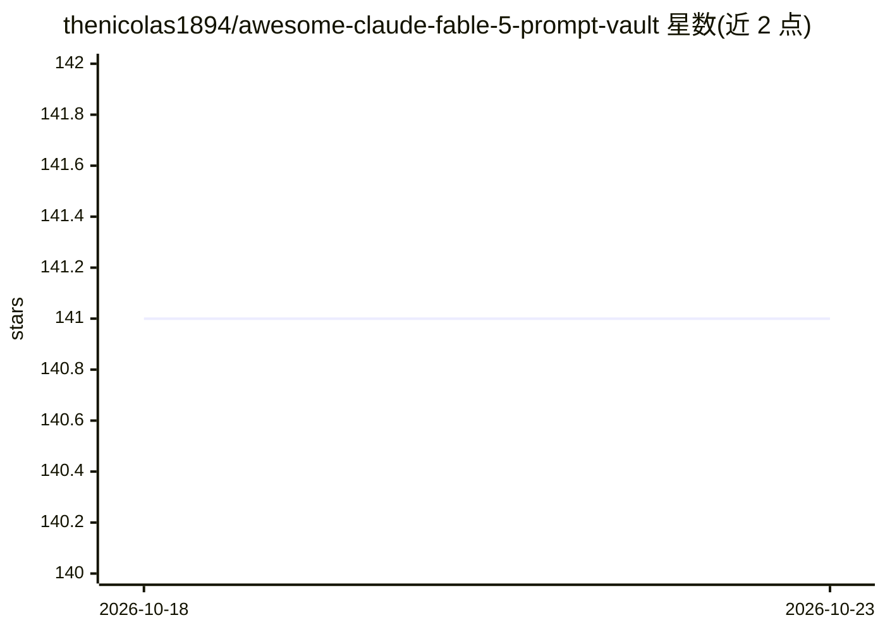

# thenicolas1894/awesome-claude-fable-5-prompt-vault

⭐ 141 · HTML · 推送 2026-10-22 · [GitHub](https://github.com/thenicolas1894/awesome-claude-fable-5-prompt-vault) · 个人维护

**提示工程模式知识库：模板、评估框架与部署蓝图合集**

名为 NeuroPrompt Studio 的知识共享仓库（自述非软件产品），收录提示工程的原子模式（zero-shot、思维链、思维树等）、多步工作流蓝图、评估指标套件与生产部署配置模板。面向开发者、研究者、产品经理与创意技术从业者；条目按模式库/工作流/评估/部署四层组织，每个模式附测试用例、性能说明与领域适配指南。仓库声明模式性能不作保证，随模型更新可能失效。

## 筛选速览

| 维度 | 判定 | 备注 |
|---|---|---|
| AI 角色 | `ai-knowledge` | 知识聚合/清单类 |
| 许可风险 | `none` | — |
| 部署形态 | `None` |  |
| 模型依赖 | — | README 未给出锁定关系 |
| 硬件要求 | — | 无带数字的原话,不猜 |
| 安装摩擦 | `low` | 无编译、无系统依赖或容器化 |
| 成熟度 | — | 结构信号不足 |

## 能力要点

- 四层结构：50+ 可复用提示模式、工作流蓝图、评估套件、部署模板
- 评估维度含一致性、幻觉检测、token 效率与扰动鲁棒性
- 安全模板：内容过滤、提示注入防御、PII 脱敏、偏见缓解

## 适用场景

- 为生产 LLM 应用挑选并复用经过测试的提示模式
- 对提示变体做 A/B 测试与性能评估
- 参考部署模板搭建 API 编排、限流与重试逻辑

## 场景标签

 · 领域:LLM 提示工程/知识聚合

## 证据(README 行号)

> L3: # 🧠 NeuroPrompt Studio
> L5: **Master the art of intelligent prompt engineering with a curated ecosystem of patterns, templates, evaluation frame
> L152: NeuroPrompt Studio is a **knowledge-sharing repository**, not a software product. The patterns, templates, and wor

## 星数曲线

2026-10-18 141 → 2026-10-23 141（+0）

---
*卡片 v1 · prompt 1.4 · 生成 2026-10-23 · 置信度 high · 依据 README sha `fcf10e389775` · [字段定义](../../DATASET.md)*
