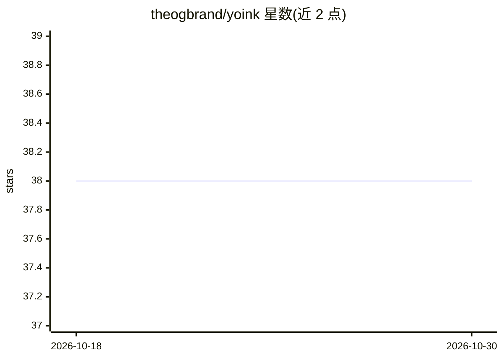

# theogbrand/yoink

⭐ 38 · Python · MIT · 推送 2026-04-04 · [GitHub](https://github.com/theogbrand/yoink) · 个人维护

**给开发者的 Claude Code 插件：用 AI 重实现依赖包所需子集**

YOINK 是一个 Claude Code 插件，以 AI agent 形式将第三方 Python 依赖分解为内部替代实现：给定目标仓库 URL，先克隆并搭建本地替代包脚手架，再参照原库测试期望生成并验证新测试，最后按既定原则迭代分解依赖，产出无依赖的本地替代实现。前置依赖为 uv。当前仅支持 Python 包（计划支持 JavaScript），不适用于大型框架、平台绑定库与加密实现。通过 Claude Code 插件市场安装，也可本地克隆后以 --plugin-dir 运行。

## 筛选速览

| 维度 | 判定 | 备注 |
|---|---|---|
| AI 角色 | `ai-ecosystem` | LLM/agent 周边工具 |
| 许可风险 | `permissive` | MIT |
| 部署形态 | `None` |  |
| 模型依赖 | locked-api |  |
| 硬件要求 | — | 无带数字的原话,不猜 |
| 安装摩擦 | `low` | 无编译、无系统依赖或容器化 |
| 成熟度 | — | 结构信号不足 |

## 能力要点

- 三阶段技能流程：setup / curate-tests / decompose，可分阶段恢复执行
- 生成的测试依据原库测试套件的期望进行验证
- 生成测试后对照真实库安装版本进行校验
- 支持通过 --skip-test-discoverer 跳过测试发现步骤

## 适用场景

- 把我只用少部分功能的工具库替换为内部精简实现
- 减少项目第三方依赖数量以缩小供应链攻击面
- 替换维护状态不明的中小型 Python 包

## 场景标签

`编码 Agent` · 领域:编码与开发

## 证据(README 行号)

> L5: YOINK is currently built as a Claude Code plugin that decomposes third-party
> L63: yoink runs three skills sequentially:
> L65: 1. **`/yoink:setup`** clones the target repo and scaffolds a local replacement package.

## 星数曲线

2026-10-18 38 → 2026-10-30 38（+0）

---
*卡片 v1 · prompt 1.4 · 生成 2026-10-25 · 置信度 high · 依据 README sha `1bd20f07d002` · [字段定义](../../DATASET.md)*
