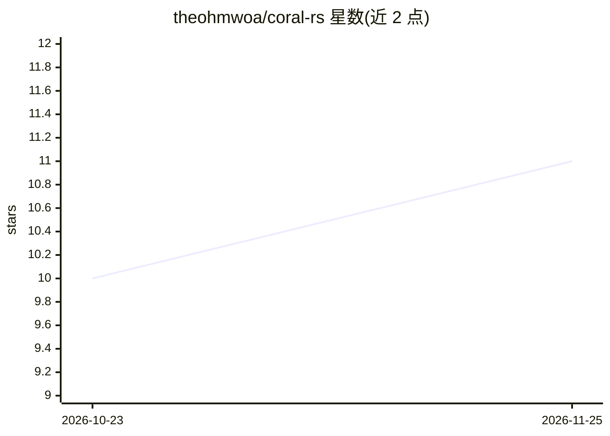

# theohmwoa/coral-rs

⭐ 11 · Rust · Apache-2.0 · 推送 2026-07-24 · [GitHub](https://github.com/theohmwoa/coral-rs) · 个人维护

**Coral USB 加速器的纯 Rust 驱动与推理运行时**

面向 Rust 开发者的 Google Coral USB Accelerator（Edge TPU）驱动与推理栈：以纯 Rust nusb 实现用户态 USB 协议，覆盖 DFU 固件烧录、CSR 寄存器芯片启动、模型解析与 ML 传输，无需 libedgetpu、TFLite 运行时或内核驱动即可运行编译后的 edgetpu 模型，支持分类与 SSD 目标检测后处理。当前为实验状态，仅支持 USB 加速器（M.2/PCIe 不在范围内）；设备一次仅运行一个 ModelRunner，断电后固件需重新烧录（自动处理）。

## 筛选速览

| 维度 | 判定 | 备注 |
|---|---|---|
| AI 角色 | `ai-native` | 本体是模型或模型工具 |
| 许可风险 | `permissive` | Apache-2.0 |
| 部署形态 | `library` | 以包/库形式分发 |
| 模型依赖 | — | README 未给出锁定关系 |
| 硬件要求 | — | 无带数字的原话,不猜 |
| 安装摩擦 | `medium` | 含编译或系统依赖之一 |
| 成熟度 | `idea` | |

## 能力要点

- 纯 Rust nusb 实现，进程中不含 libedgetpu/TFLite 运行时/内核驱动
- 支持分类推理与 SSD 检测（含 box 解码与 NMS），输出与官方栈逐位一致
- 内置固件 blob，断电重插后自动发现并烧录固件、完成芯片启动
- 提供可选 FFI 绑定（edgetpu-sys/edgetpu）作为交叉验证 oracle

## 适用场景

- 在 Rust 项目中直接驱动 Coral USB Accelerator 做边缘推理
- 不依赖 C/C++ 构建链的内存安全 Edge TPU 集成
- 对新内核/Linux 发行版需要用户态 USB 方案的场景

## 场景标签

`推理引擎` `目标检测` · 领域:感知与多模态

## 证据(README 行号)

> L3: **A pure-Rust driver and inference runtime for the Google Coral USB Accelerator (Edge TPU).**
> L11: Run compiled Edge TPU models with **no C or C++ in your process**: no `libedgetpu`, no

## 星数曲线

2026-10-23 10 → 2026-11-25 11（+1）

---
*卡片 v1 · prompt 1.4 · 生成 2026-11-19 · 置信度 high · 依据 README sha `180960835225` · [字段定义](../../DATASET.md)*
