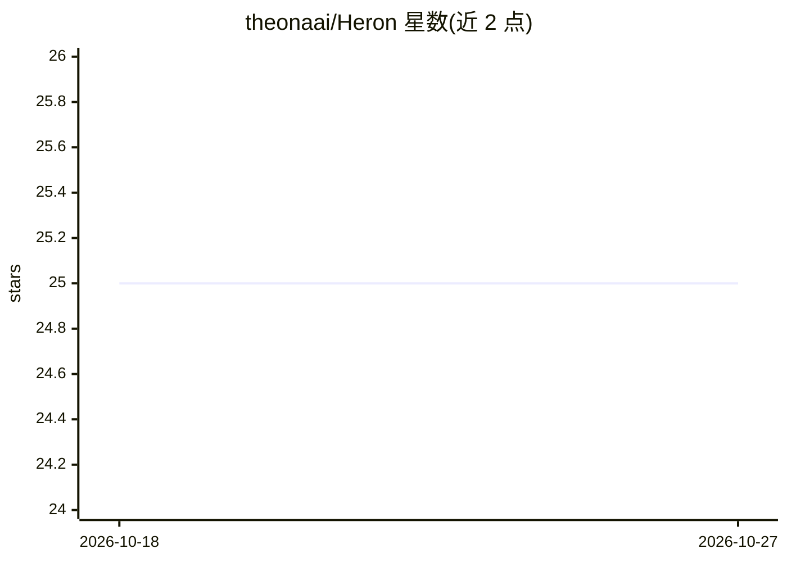

# theonaai/Heron

⭐ 25 · TypeScript · MIT · 推送 2026-06-10 · [GitHub](https://github.com/theonaai/Heron) · [官网](https://heron.ing) · 组织维护

**开源 AI agent 审计工具：核验 agent 声称的权限与实际访问**

面向安全与合规审查者的 agent 审计器：通过 MCP 向 agent 提出 17 个合规问题（系统与范围、数据敏感性、不可逆写入、爆炸半径等），再以确定性读取（运行时配置、OAuth scope 内省、MCP tools/list、.env 键名枚举）与 agent 的回答做 diff，产出 Verified/Discrepancy/Could not verify/Self-attested 四态报告，风险分仅由已验证证据计算。报告映射 EU AI Act、GDPR、ISO 42001 等框架。凭据只记录键名不读值，扫描需显式授权，默认仅绑定 loopback。支持 CI 无头扫描与 Markdown/HTML 导出。

## 筛选速览

| 维度 | 判定 | 备注 |
|---|---|---|
| AI 角色 | `ai-ecosystem` | LLM/agent 周边工具 |
| 许可风险 | `permissive` | MIT |
| 部署形态 | `library` | 以包/库形式分发 |
| 模型依赖 | locked-api |  |
| 硬件要求 | — | 无带数字的原话,不猜 |
| 安装摩擦 | `low` | 无编译、无系统依赖或容器化 |
| 成熟度 | — | 结构信号不足 |

## 能力要点

- MCP 面试 + 确定性基础设施核验的 diff 审计
- 四态验证词汇：已验证声明才计入风险分
- 合规覆盖 EU AI Act / GDPR / ISO 42001 / AIUC-1 / NIST AI RMF
- 凭据仅记键名、OAuth token 不经过 Heron、扫描需同意授权

## 适用场景

- 上线前搞清楚我的 agent 实际能访问哪些系统
- 对 agent 声称的权限做合规与安全审查
- 在 CI 中做声明与实际工具清单的偏差检查

## 场景标签

`网络安全` · 领域:学习与行业

## 证据(README 行号)

> L20: Heron asks the agent itself, and then checks the answers. The agent explains what it does over MCP; Heron reads the
> L81: 5. **Compliance lens**: per-framework control coverage across EU AI Act, GDPR, ISO/IEC 42001, AIUC-1, and NIST AI R

## 星数曲线

2026-10-18 25 → 2026-10-27 25（+0）

---
*卡片 v1 · prompt 1.4 · 生成 2026-10-26 · 置信度 high · 依据 README sha `e1e8a3a8b421` · [字段定义](../../DATASET.md)*
