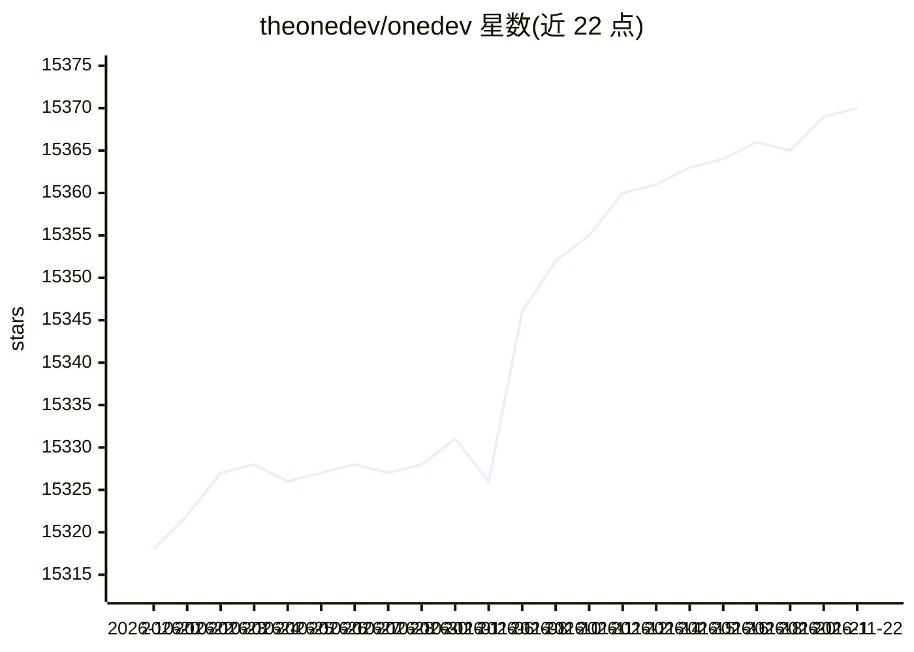

# theonedev/onedev

⭐ 15,370 · Java · MIT · 推送 2026-11-19 · [GitHub](https://github.com/theonedev/onedev) · [官网](https://onedev.io) · 组织维护

**自托管 DevOps 平台：Git 托管、CI/CD、issue 一体化**

面向开发团队的自托管一体化开发平台，覆盖代码搜索与导航、拉取请求与代码保护规则、看板与 issue 工作流、CI/CD 编排（容器/裸机/VM/Kubernetes 执行器）、内置包仓库、版本化 Wiki、服务台与时间统计。内置 AI 功能支持自然语言查询、代码解释、commit/PR 审查、CI/CD 规格辅助与构建错误排查；提供 Workspaces 在浏览器中运行终端编码 agent，并附带 CLI 与技能供 agent 操作 issue、PR 与 CI/CD。服务器与 agent 支持 Linux/Windows（amd64/arm64）及 Apple Silicon macOS。

## 筛选速览

| 维度 | 判定 | 备注 |
|---|---|---|
| AI 角色 | `ai-enhanced` | 去掉 AI 部分产品仍成立 |
| 许可风险 | `permissive` | MIT |
| 部署形态 | `None` |  |
| 模型依赖 | — | README 未给出锁定关系 |
| 硬件要求 | — | 无带数字的原话,不猜 |
| 安装摩擦 | `low` | 无编译、无系统依赖或容器化 |
| 成熟度 | — | 结构信号不足 |

## 动量与使用信号

- 维护:`active` — 距上次 push 1.3 天,年发版 100,34 位贡献者
- 涨星:近 1 天 **+5**(自 20261016 起算)
- 平台:WINDOWS / MACOS / LINUX · 协议:MCP

## 能力要点

- GUI 式 CI/CD 编排，支持容器、裸机、沙箱 VM 与 Kubernetes 执行器
- 内置 AI：自然语言查询、代码解释、PR 审查与构建错误排查
- Workspaces 支持在浏览器中使用 OpenCode、Claude Code、Codex 等终端 agent
- 内置包仓库、版本化 Wiki、看板与服务台集成

## 适用场景

- 团队自托管代码托管与 CI/CD 流水线
- 用 AI agent 自动实现 issue、审查 PR 并修复构建失败
- 通过看板与自动化规则管理 issue 工作流

## 场景标签

`代码审查` · 领域:编码与开发

## 证据(README 行号)

> L3:  The Unified and Autonomous Development Platform
> L157: ## 🤖 Built-in AI for DevOps Intelligence
> L166: Work on any branch in preconfigured dev containers or isolated sandbox VMs.

## 星数曲线

2026-10-20 15,318 → 2026-11-22 15,370（+52）

---
*卡片 v1 · prompt 1.4 · 生成 2026-11-22 · 置信度 high · 依据 README sha `ee1e1937547a` · [字段定义](../../DATASET.md)*
