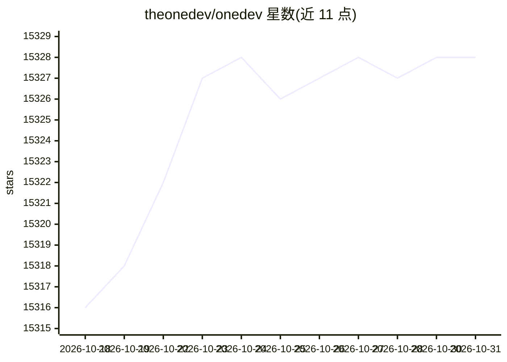

# theonedev/onedev

⭐ 15,328 · Java · MIT · 推送 2026-10-30 · [GitHub](https://github.com/theonedev/onedev) · [官网](https://onedev.io) · 组织维护

**自托管 DevOps 平台：代码托管+CI/CD+_issue 管理+AI 助手**

自托管的统一开发平台，覆盖代码搜索与导航、pull request 与代码保护规则、issue 工作流与看板、服务台邮件联动、CI/CD 编辑器与多种执行器（容器/Kubernetes/agent）、内置包仓库、版本化 Wiki、仪表盘与高可用集群。AI 部分：内置自然语言查询、代码解释、提交与 PR 审查、构建错误排查；AI 用户可在 issue/PR 流程中自主实现任务、修复失败；Workspaces 在浏览器中提供预配置 dev container 以运行终端编码 agent。README 注明服务器最低可在 1 核 2G 内存环境运行中型项目。

## 筛选速览

| 维度 | 判定 | 备注 |
|---|---|---|
| AI 角色 | `ai-enhanced` | 去掉 AI 部分产品仍成立 |
| 许可风险 | `permissive` | MIT |
| 部署形态 | `None` |  |
| 模型依赖 | — | README 未给出锁定关系 |
| 硬件要求 | — | 无带数字的原话,不猜 |
| 安装摩擦 | `low` | 无编译、无系统依赖或容器化 |
| 成熟度 | — | 结构信号不足 |

## 动量与使用信号

- 维护:`active` — 距上次 push 1.3 天,年发版 100,34 位贡献者
- 涨星:近 1 天 **+5**(自 20261016 起算)
- 平台:WINDOWS / MACOS / LINUX · 协议:MCP

## 能力要点

- 内置 AI：自然语言查询、代码解释、PR 审查、CI/CD 规格辅助与构建错误调查
- AI 用户在 issue/PR 流程中自主实现 issue、修复 CI 失败与合并冲突
- Workspaces 提供服务端预配置 dev container，浏览器内使用终端编码 agent
- TOD CLI 与内置 skills 供编码 agent 查询/编辑 issue、PR、build 并触发 CI

## 适用场景

- 自托管一体化管理代码托管、CI/CD 与项目看板
- 让 AI 以团队成员身份认领 issue、审查 PR 并修复构建失败
- 在浏览器中用 Claude Code 等终端 agent 直接开发，免去本地环境配置

## 场景标签

`编码 Agent` `代码审查` · 领域:编码与开发

## 证据(README 行号)

> L156: ## 🤖 Built-in AI for DevOps Intelligence
> L165: Work on any branch with preconfigured dev containers on server. Use OpenCode, Claude Code, Codex, or other termina
> L179: AI users work autonomously in your issue and pull request flow: implement assigned issues, review and improve pull

## 星数曲线

2026-10-18 15,316 → 2026-10-31 15,328（+12）

---
*卡片 v1 · prompt 1.4 · 生成 2026-10-18 · 置信度 high · 依据 README sha `baaab18e8ff7` · [字段定义](../../DATASET.md)*
