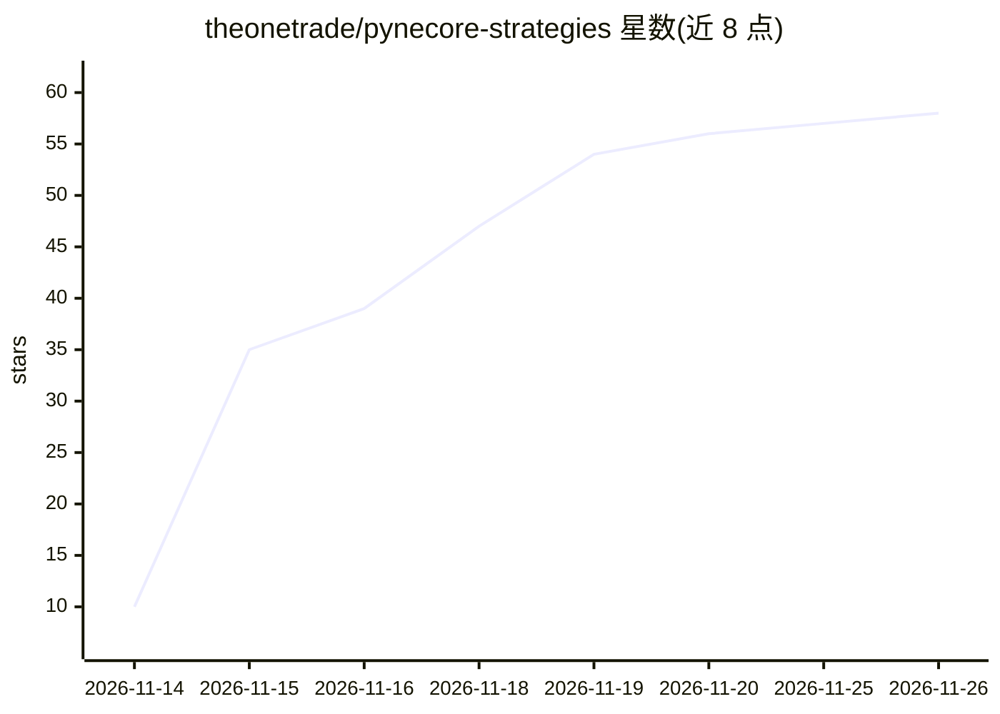

# theonetrade/pynecore-strategies

⭐ 58 · Python · MIT · 推送 2026-11-08 · [GitHub](https://github.com/theonetrade/pynecore-strategies) · [官网](https://theonetrade.github.io) · 组织维护

**449 个 TradingView 策略的 Pine→Python 离线回测脚本集**

收录 TradingView 社区开源 Pine 脚本并经 PyneSys 云编译器转为 PyneCore Python 脚本的仓库：449 个策略、471 个指标、85 个 Pine 库，其中 384 个策略与 458 个指标达到与 TradingView 逐 bar 位级一致。本地用 pyne CLI 从任意 CCXT 交易所下载 K 线缓存后离线回测，输出逐笔交易、策略统计与逐 bar 数据 CSV；原始 Pine 源码按字节保留在 assets/ 目录。脚本可批量测试或喂给特征管线/LLM agent。重编译需 pynesys.io API key，有每小时/每日配额限制。

## 筛选速览

| 维度 | 判定 | 备注 |
|---|---|---|
| AI 角色 | `ai-knowledge` | 知识聚合/清单类 |
| 许可风险 | `permissive` | MIT |
| 部署形态 | `library` | 以包/库形式分发 |
| 模型依赖 | — | README 未给出锁定关系 |
| 硬件要求 | — | 无带数字的原话,不猜 |
| 安装摩擦 | `low` | 无编译、无系统依赖或容器化 |
| 成熟度 | — | 结构信号不足 |

## 能力要点

- 1,005 个 Pine 源全部编译通过并保留原始源码（v4/v5/v6 混合）
- 384 个策略与 458 个指标达到与 TradingView 位级一致
- 任意 CCXT 交易所 K 线离线回测，输出交易明细与统计 CSV
- 通过 npx skills 安装的 pynecore-skills 支持 Claude Code/Cursor/Codex

## 适用场景

- 不装 TradingView、离线回测社区开源策略
- 在 TradingView 未收录的交易所上跑这些策略
- 把策略输出接入特征管线或 LLM agent 做批量分析

## 场景标签

`金融量化` · 领域:学习与行业

## 证据(README 行号)

> L3:  TradingView community strategies, running offline in Python
> L4:  449 strategies, 471 indicators and 85 libraries compiled from Pine Script to PyneCore.
> L184: The project was built with pynecore-skills, agent

## 星数曲线

2026-11-14 10 → 2026-11-26 58（+48）

---
*卡片 v1 · prompt 1.4 · 生成 2026-11-18 · 置信度 mid · 依据 README sha `2a699b58cf35` · [字段定义](../../DATASET.md)*
