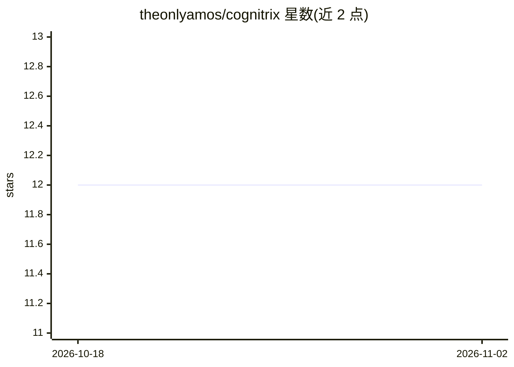

# theonlyamos/cognitrix

⭐ 12 · Python · Apache-2.0 · 推送 2026-11-01 · [GitHub](https://github.com/theonlyamos/cognitrix) · 个人维护

**开源自主 AI agent 编排框架：创建、管理并运行带工具的 agent**

Python 实现的自主 AI agent 编排框架，提供 Agent 基类创建与管理 agent，可挂载计算器、网页搜索、文件系统浏览等工具，支持自主模式（感知屏幕并操作 UI）。LLM 接入以 OpenRouter 为主（200+ 模型），另支持 OpenAI 直连与 Ollama 本地模型，支持文本与图像多模态。交付形态含 CLI、React Web UI、HTTP API（含 OpenAI 兼容端点、API key 权限、任务调度与 webhook）、Docker Compose 部署。要求 Python 3.11–3.13，不支持 3.10 及以下。

## 筛选速览

| 维度 | 判定 | 备注 |
|---|---|---|
| AI 角色 | `ai-ecosystem` | LLM/agent 周边工具 |
| 许可风险 | `permissive` | Apache-2.0 |
| 部署形态 | `self-host` | docker 或自建部署 |
| 模型依赖 | local-ok | 支持本地模型 |
| 硬件要求 | — | 无带数字的原话,不猜 |
| 安装摩擦 | `low` | 无编译、无系统依赖或容器化 |
| 成熟度 | — | 结构信号不足 |

## 能力要点

- Agent 创建/管理与可扩展工具体系（Tool 基类继承）
- OpenRouter 200+ 模型接入，另支持 OpenAI 直连与 Ollama 本地模型
- 自主模式：屏幕感知与 UI 元素交互
- HTTP API：细粒度 scope 的 API key、任务/team 运行与调度、webhook HMAC 验签、OpenAI 兼容端点

## 适用场景

- 创建并运行带工具调用的 AI agent 处理任务
- 通过 Web UI 或 CLI 与 agent 对话并管理配置
- 部署带 Celery worker 与 Redis 的多服务 agent 服务
- 以 OpenAI SDK 兼容方式从外部程序调用 agent

## 场景标签

`Agent 框架` · 领域:Agent 开发

## 证据(README 行号)

> L3: Cognitrix is an open-source autonomous AI agents orchestrator built in Python. It allows you to create and manage AI
> L20: - **LLMs:** Provider classes for OpenRouter (primary - 200+ models), OpenAI (direct), and Ollama (local).

## 星数曲线

2026-10-18 12 → 2026-11-02 12（+0）

---
*卡片 v1 · prompt 1.4 · 生成 2026-10-31 · 置信度 mid · 依据 README sha `51a9c50e9e86` · [字段定义](../../DATASET.md)*
