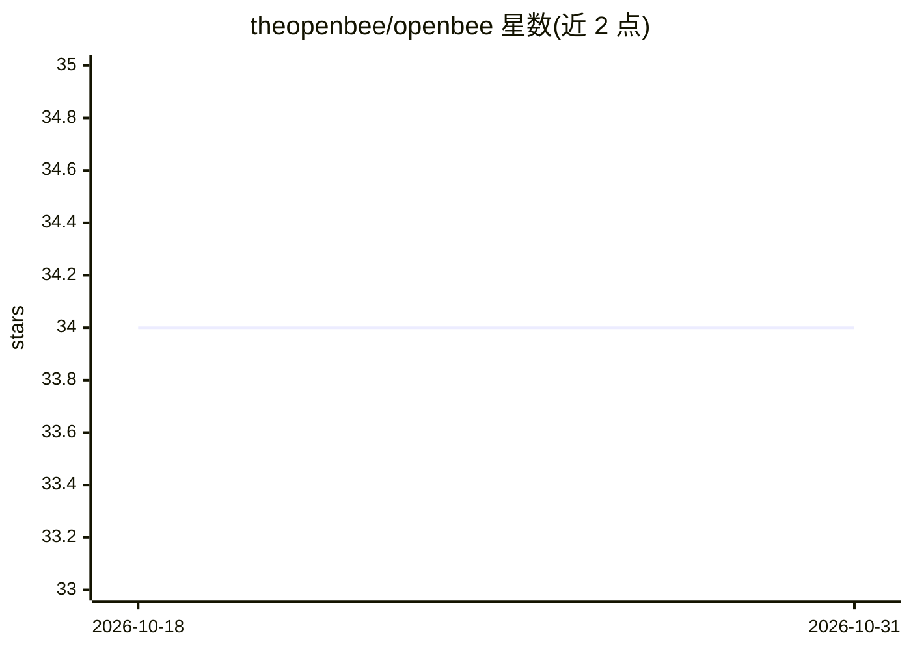

# theopenbee/openbee

⭐ 34 · Go · MIT · 推送 2026-10-30 · [GitHub](https://github.com/theopenbee/openbee) · 组织维护 · 中文 README

**自托管服务：把 Claude Code/Codex/Pi 等 AI agent 接入聊天平台使用**

OpenBee 是一个自托管（self-hosted）的数字员工服务：将 Claude Code、Codex、Pi 等 AI agent 接入 Lark/飞书、钉钉、企业微信、微信、Telegram、Linear 及浏览器 Web 控制台，实现 7×24 小时随时调用。通过向导式配置（openbee config）指定 agent 可执行文件路径与各平台凭据，生成 config.yaml 后以 openbee server 启动服务，Web 控制台默认在 localhost:8080 管理 Worker 并查看任务状态。支持 Linux/macOS/Windows（amd64 与 arm64），提供 npm、一键脚本、brew、scoop 与手动二进制多种安装方式。

## 筛选速览

| 维度 | 判定 | 备注 |
|---|---|---|
| AI 角色 | `ai-ecosystem` | LLM/agent 周边工具 |
| 许可风险 | `permissive` | MIT |
| 部署形态 | `library` | 以包/库形式分发 |
| 模型依赖 | — | README 未给出锁定关系 |
| 硬件要求 | — | 无带数字的原话,不猜 |
| 安装摩擦 | `low` | 无编译、无系统依赖或容器化 |
| 成熟度 | — | 结构信号不足 |

## 能力要点

- 把 Claude Code / Codex / Pi 等 agent 接入 6 个聊天平台与浏览器
- 向导式生成 config.yaml 配置各平台凭据与 agent 可执行路径
- Web 控制台管理 Worker 并查看任务状态
- 支持 Linux/macOS/Windows（amd64 & arm64）多种安装途径

## 适用场景

- 在钉钉/飞书/微信/Telegram 里直接调用我的 Claude Code agent
- 自托管一个 7×24 在线的 AI 数字员工服务
- 通过 Web 控制台集中管理多个 agent Worker 与任务

## 场景标签

`Agent 框架` · 领域:Agent 开发

## 证据(README 行号)

> L5: **OpenBee** is an around-the-clock digital worker solution, dedicated to making AI Agents your 7×24 always-on assist
> L64: - Platform(s) to enable (Lark / DingTalk / WeCom / WeChat / Telegram / Linear) and their credentials
> L81: - Open the Web Console (default http://localhost:8080) to manage Workers and view task status

## 星数曲线

2026-10-18 34 → 2026-10-31 34（+0）

---
*卡片 v1 · prompt 1.4 · 生成 2026-10-25 · 置信度 high · 依据 README sha `f002c38bfde8` · [字段定义](../../DATASET.md)*
