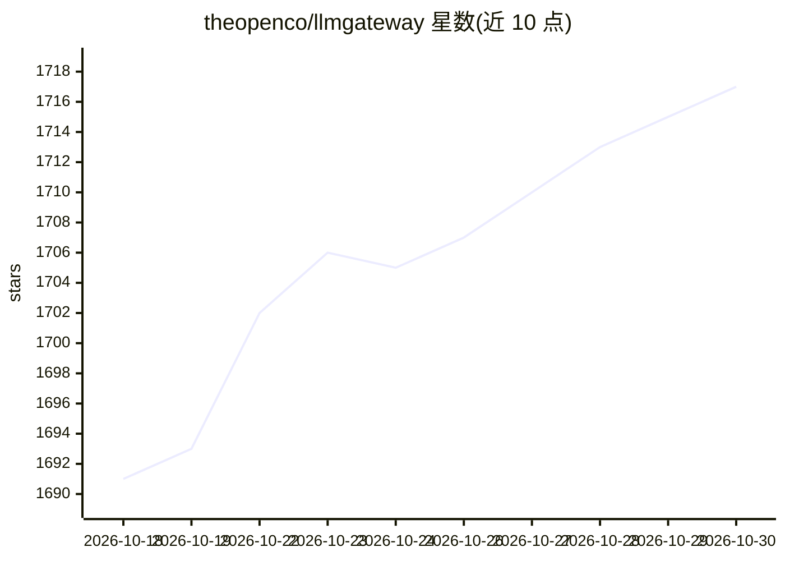

# theopenco/llmgateway

⭐ 1,717 · TypeScript · NOASSERTION · 推送 2026-10-29 · [GitHub](https://github.com/theopenco/llmgateway) · [官网](https://llmgateway.io) · 组织维护

**统一 API 接口的 LLM 网关：多供应商路由与用量分析**

开源的 LLM API 网关中间件，位于应用与各 LLM 供应商之间：将请求路由到 OpenAI、Anthropic、Google Vertex AI 等多个供应商，集中管理供应商 API key，追踪 token 用量与成本，并提供性能指标对比分析。对外提供兼容 OpenAI API 格式的统一接口；可用托管版（llmgateway.io）或 Docker 自托管。提供商接入通过 Airside 自服务门户注册而非 PR。企业版包含计费管理、完整请求载荷保留、团队管理等，需联系获取许可。

## 筛选速览

| 维度 | 判定 | 备注 |
|---|---|---|
| AI 角色 | `ai-ecosystem` | LLM/agent 周边工具 |
| 许可风险 | `none` | NOASSERTION |
| 部署形态 | `self-host` | docker 或自建部署 |
| 模型依赖 | — | README 未给出锁定关系 |
| 硬件要求 | — | 无带数字的原话,不猜 |
| 安装摩擦 | `low` | 无编译、无系统依赖或容器化 |
| 成熟度 | — | 结构信号不足 |

## 能力要点

- 多供应商统一路由与 API key 集中管理
- 兼容 OpenAI API 格式的统一接口
- token 用量、成本与性能指标追踪分析
- Docker 自托管或托管版两种使用方式

## 适用场景

- 应用通过统一接口接入多个 LLM 供应商
- 集中管理与审计各供应商的 token 用量和成本
- 对比不同模型的性能与成本后做选型
- 在企业内自托管 LLM 网关以掌控数据

## 场景标签

`模型网关` `LLM 可观测性` · 领域:Agent 开发

## 证据(README 行号)

> L3: LLM Gateway is an open-source API gateway for Large Language Models (LLMs). It acts as a middleware between your app
> L5: - Route requests to multiple LLM providers (OpenAI, Anthropic, Google Vertex AI, and others)
> L82: - `apps/gateway`: API gateway for routing LLM requests

## 星数曲线

2026-10-18 1,691 → 2026-10-30 1,717（+26）

---
*卡片 v1 · prompt 1.4 · 生成 2026-10-21 · 置信度 mid · 依据 README sha `8cd6c6278237` · [字段定义](../../DATASET.md)*
