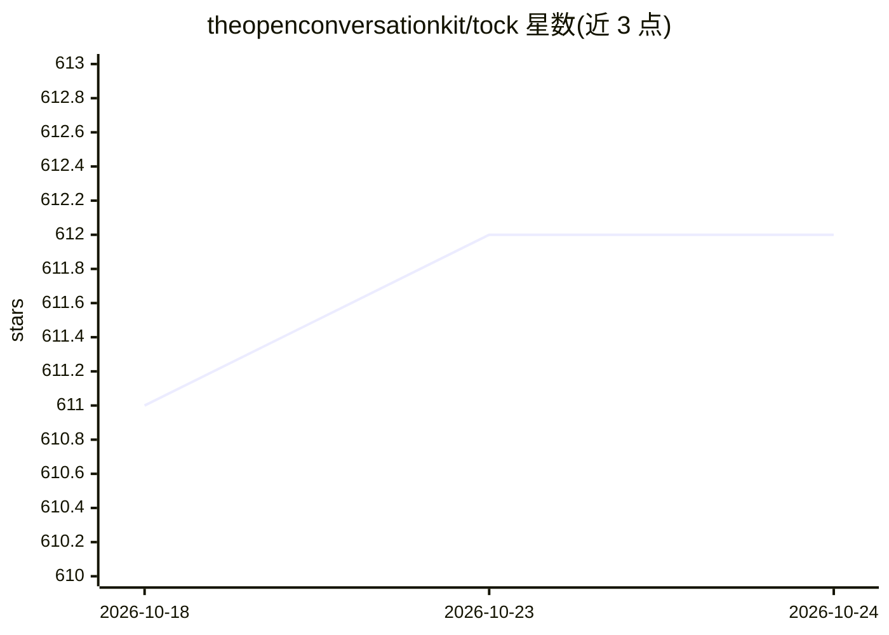

# theopenconversationkit/tock

⭐ 612 · Kotlin · Apache-2.0 · 推送 2026-10-23 · [GitHub](https://github.com/theopenconversationkit/tock) · [官网](https://doc.tock.ai) · 组织维护

**开源对话式 AI 平台：构建带 RAG 与 NLP 的聊天机器人**

面向构建聊天机器人/助手的开源对话式 AI 平台（The Open Conversation Kit）。提供基于文档的 RAG 生成式回答，可接 OpenAI、Azure OpenAI、AWS Bedrock 或 Ollama 模型，配 PGVector 或 OpenSearch 向量库，并与确定性故事（stories）结合；NLP 栈兼容 OpenNLP、Rasa、Amazon SageMaker 等。含 Tock Studio 图形界面、Kotlin/Nodejs/Python/REST 的对话 DSL、Web/WhatsApp/Messenger/Teams/Slack 等渠道连接器，支持 Docker/Kubernetes（Helm）云上或本地部署。主体为 Kotlin/Maven 项目。

## 筛选速览

| 维度 | 判定 | 备注 |
|---|---|---|
| AI 角色 | `ai-ecosystem` | LLM/agent 周边工具 |
| 许可风险 | `permissive` | Apache-2.0 |
| 部署形态 | `library` | 以包/库形式分发 |
| 模型依赖 | local-ok | 支持本地模型 |
| 硬件要求 | — | 无带数字的原话,不猜 |
| 安装摩擦 | `low` | 无编译、无系统依赖或容器化 |
| 成熟度 | — | 结构信号不足 |

## 能力要点

- RAG 回答支持 OpenAI/Azure OpenAI/Bedrock/Ollama 模型与 PGVector/OpenSearch 向量库
- Tock Studio 图形界面构建故事、配置生成式 AI、分析对话
- 内置 Web、WhatsApp、Messenger、Teams、Slack 等多渠道连接器
- 提供 Kotlin/Nodejs/Python/REST 对话 DSL 与 React/Vue Web 集成工具包

## 适用场景

- 企业构建接入 WhatsApp/Teams 等渠道的客服或助手机器人
- 基于自有文档搭建 RAG 问答机器人
- 在云上或本地（Docker/Kubernetes）部署对话平台

## 场景标签

`聊天机器人` `RAG` · 领域:对话与助手

## 证据(README 行号)

> L19: Open Conversational AI platform to build Bots:
> L21: * _Generative AI_: RAG answers from your documents, with OpenAI, Azure OpenAI, AWS Bedrock or Ollama models
> L24: * _Tock Studio_ user interface to build stories, configure the generative AI and analyze conversations

## 星数曲线

2026-10-18 611 → 2026-10-24 612（+1）

---
*卡片 v1 · prompt 1.4 · 生成 2026-10-21 · 置信度 mid · 依据 README sha `1047d5f22fbf` · [字段定义](../../DATASET.md)*
