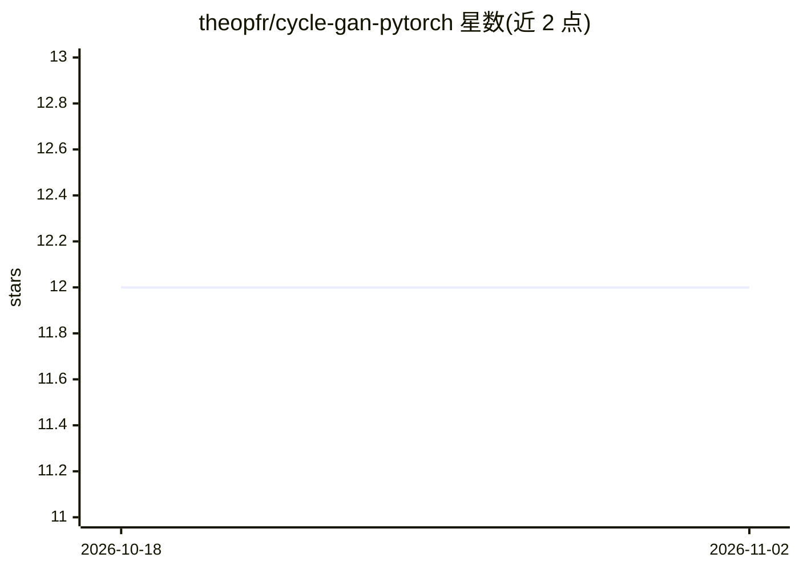

# theopfr/cycle-gan-pytorch

⭐ 12 · Python · 推送 2026-07-21 · [GitHub](https://github.com/theopfr/cycle-gan-pytorch) · 个人维护

**PyTorch 实现的 Cycle-GAN：训练模型做图像风格迁移**

按原始论文实现的 Cycle-GAN 架构 PyTorch 代码库，用于无配对图像的风格迁移（如马↔斑马）。用户在 datasets/ 下建 trainA/trainB 两类图像文件夹，通过命令行参数运行 train.py 训练，可配置轮数、图像尺寸、残差块数量、学习率与对抗/循环/一致性损失权重等超参数；训练过程在 runs/ 目录保存指标、模型检查点与生成图像，并支持中断续训。默认超参数取自原论文的 horse-zebra 数据集设置。

## 筛选速览

| 维度 | 判定 | 备注 |
|---|---|---|
| AI 角色 | `ai-native` | 本体是模型或模型工具 |
| 许可风险 | `none` | — |
| 部署形态 | `library` | 以包/库形式分发 |
| 模型依赖 | — | README 未给出锁定关系 |
| 硬件要求 | — | 无带数字的原话,不猜 |
| 安装摩擦 | `low` | 无编译、无系统依赖或容器化 |
| 成熟度 | — | 结构信号不足 |

## 能力要点

- 按原始论文实现的 Cycle-GAN 训练代码
- 命令行参数配置训练超参数，支持中断续训
- 训练产出指标、检查点与生成图像，按间隔保存

## 适用场景

- 在自建两类图像数据集上训练风格迁移模型
- 复现论文中 horse-zebra 等风格迁移实验

## 场景标签

`图像生成` · 领域:内容生成

## 证据(README 行号)

> L1: # 🐴🔄🦓 Cycle-GAN implemented in PyTorch
> L3: ### This repository contains an implementation of the Cylce-GAN architecture as proposed in the original paper along

## 星数曲线

2026-10-18 12 → 2026-11-02 12（+0）

---
*卡片 v1 · prompt 1.4 · 生成 2026-10-31 · 置信度 mid · 依据 README sha `2c4057b3a050` · [字段定义](../../DATASET.md)*
