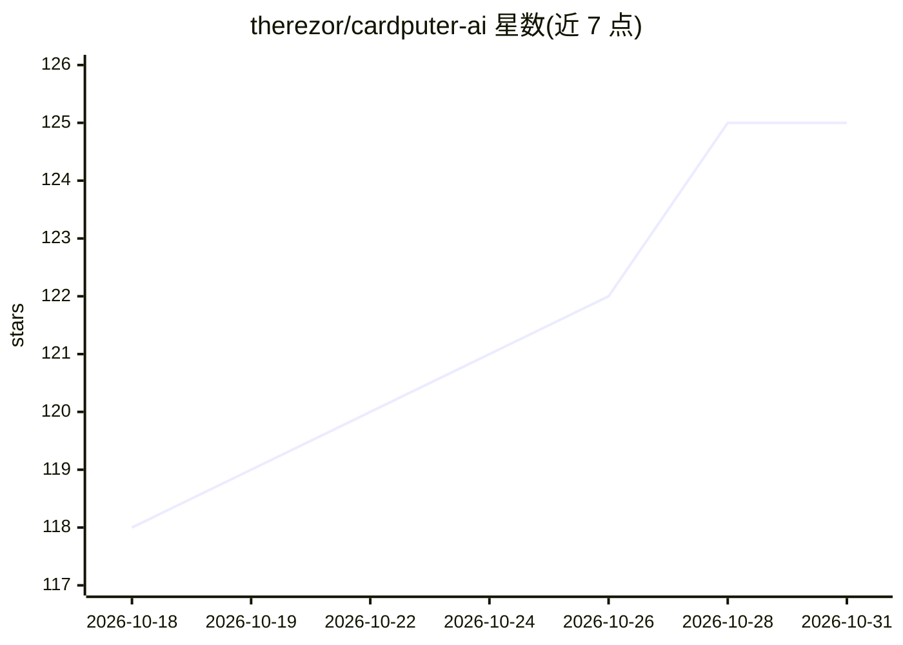

# therezor/cardputer-ai

⭐ 125 · C++ · NOASSERTION · 推送 2026-09-25 · [GitHub](https://github.com/therezor/cardputer-ai) · 个人维护

**跑在 ESP32-S3 微控制器上的完全离线 8M 参数小型聊天模型固件**

面向 M5Stack Cardputer/Cardputer ADV 硬件的固件项目：内置 TinyTalk 2 模型（8M 参数，Q4 量化烘焙进固件，5.7 MB），在 512 KB RAM、无 PSRAM 的 ESP32-S3 上以约 5 tok/s 进行英文对话与故事生成，完全离线。模型基于 TinyStories-Instruct-8M 微调，采用 int4 KV 缓存、SIMD Q4×Q8 矩阵核与滑动上下文窗口（64 token 预算，记忆约 3 条消息）。能力限于闲聊、简单事实与短故事；固件经 M5Launcher 刷入，也提供 ollama 在电脑上运行同一模型。代码 MIT，模型部分数据集含非商用条款。

## 筛选速览

| 维度 | 判定 | 备注 |
|---|---|---|
| AI 角色 | `ai-native` | 本体是模型或模型工具 |
| 许可风险 | `none` | NOASSERTION |
| 部署形态 | `None` |  |
| 模型依赖 | local-ok | 支持本地模型 |
| 硬件要求 | — | 无带数字的原话,不猜 |
| 安装摩擦 | `low` | 无编译、无系统依赖或容器化 |
| 成熟度 | — | 结构信号不足 |

## 能力要点

- 512 KB RAM、无 PSRAM、无外置内存芯片的 ESP32-S3 上完全离线运行 LLM 对话
- 8M 参数 Q4 权重烘焙进固件（5.7 MB），实测约 5 tok/s
- int4 KV 缓存与滑动上下文窗口（attention sink 固定四分之一窗口）
- TinyStories-Instruct-8M 微调用于对话，支持 chat/story 双模式与 top-p 采样

## 适用场景

- 在 Cardputer 掌上设备上体验完全离线的 AI 聊天
- 嵌入式/边缘 AI 的极小内存 LLM 推理参考实现
- 给儿童生成简短睡前故事或进行简单英文对话

## 场景标签

`聊天机器人` `推理引擎` · 领域:对话与助手

## 证据(README 行号)

> L6:  No internet. No cloud. No phone. Just a tiny chip with 512 KB of RAM, and it talks back.
> L121: - Model: **TinyTalk 2**, 8M parameters, fine-tuned from TinyStories-Instruct-8M for chat. Open weights on Hugging 
> L122: - Hardware: M5Stack Cardputer / Cardputer ADV. ESP32-S3 chip, 512 KB SRAM, 8 MB flash, **no PSRAM**.

## 星数曲线

2026-10-18 118 → 2026-10-31 125（+7）

---
*卡片 v1 · prompt 1.4 · 生成 2026-10-23 · 置信度 high · 依据 README sha `97ee11a6b012` · [字段定义](../../DATASET.md)*
