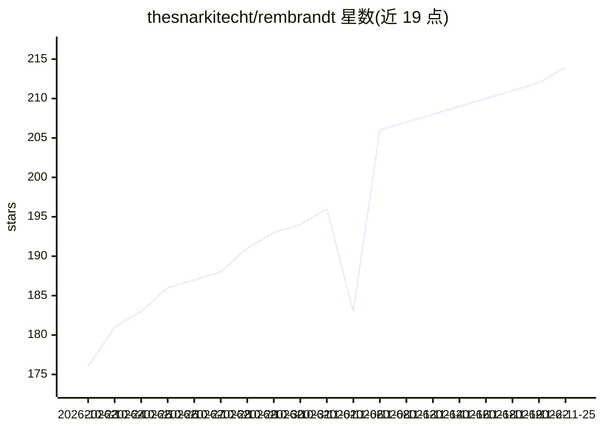

# thesnarkitecht/rembrandt

⭐ 214 · C++ · GPL-3.0 · 推送 2026-11-21 · [GitHub](https://github.com/thesnarkitecht/rembrandt) · 个人维护

**免费跨平台照片编辑器：本地 AI 修图，免账号免订阅**

面向 macOS、Windows 和 Linux 的照片编辑与图库管理应用，覆盖 RAW 显影、蒙版、HDR、合并、批量处理、图库与导入导出。AI 功能包括自然语言/语音编辑指令（设备端 36 MB 语言模型 Needle 3）、AI 蒙版、生成式移除与扩展、超分辨率、AI 降噪与 CLIP 智能搜索，均可完全关闭且不上传照片。支持自托管为浏览器可访问的服务器；编辑以 XMP 边车保存，原图不被修改。README 注明编辑引擎仍在变化，同一编辑跨版本可能呈现差异。

## 筛选速览

| 维度 | 判定 | 备注 |
|---|---|---|
| AI 角色 | `ai-enhanced` | 去掉 AI 部分产品仍成立 |
| 许可风险 | `viral` | GPL-3.0 |
| 部署形态 | `desktop` | 安装包/桌面程序 |
| 模型依赖 | — | README 未给出锁定关系 |
| 硬件要求 | — | 无带数字的原话,不猜 |
| 安装摩擦 | `low` | 无编译、无系统依赖或容器化 |
| 成熟度 | `idea` | |

## 能力要点

- 自然语言与语音下达编辑指令，Needle 3 模型在设备端运行，AI 可完全关闭
- AI 蒙版、生成式移除/扩展、超分辨率、AI 降噪均在设备端运行，不上传
- RAW 支持 1,000+ 相机机型，GPU 显影，编辑存为 XMP 边车
- 支持自托管服务，通过浏览器从任意设备编辑本机照片库

## 适用场景

- 在本地用 RAW 工作流编辑和整理照片，无需账号订阅
- 用自然语言或语音让编辑器自动调整影调与色彩
- 在家庭服务器上自托管，用浏览器从多设备访问照片库
- 从 Lightroom/Google Photos 等迁移照片与编辑记录

## 场景标签

`图像视频处理` `图像生成` · 领域:内容生成

## 证据(README 行号)

> L5:  A free photo editor for macOS, Windows and Linux.
> L80:  device; exact requests like “shadows +25” never need it, and with AI off the words still work.
> L112:  turn AI off altogether: its tools disappear and no model is downloaded or run.

## 星数曲线

2026-10-23 176 → 2026-11-25 214（+38）

---
*卡片 v1 · prompt 1.4 · 生成 2026-11-25 · 置信度 mid · 依据 README sha `273a6ae7abd0` · [字段定义](../../DATASET.md)*
