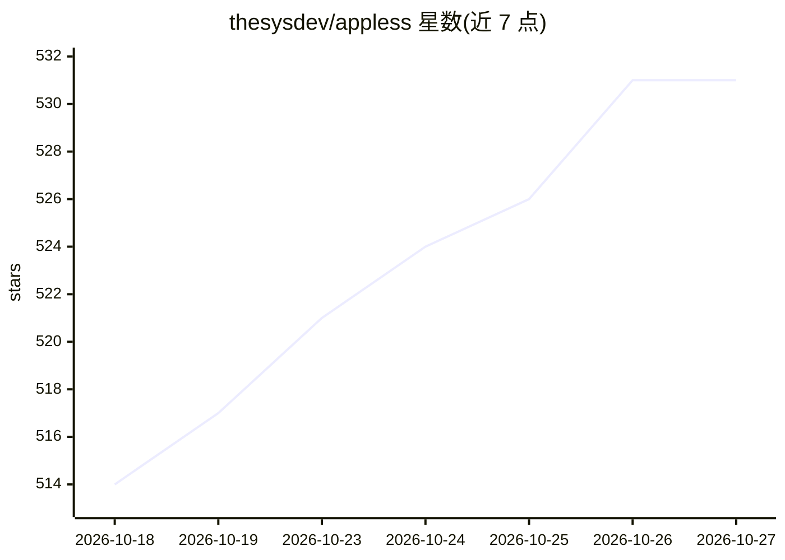

# thesysdev/appless

⭐ 531 · TypeScript · MIT · 推送 2026-09-16 · [GitHub](https://github.com/thesysdev/appless) · 组织维护

**无 App 手机概念演示：用 LLM 实时生成原生界面**

基于 Expo SDK 54 与 React Native 的实验性应用：没有预装 App 与菜单，用户用自然语言提出需求，屏幕由 OUI-1 模型即时生成并流式渲染为原生 UI（iOS Cupertino / Android Material 3）。模型输出 openui-lang DSL，由 OpenUI 渲染器解析为原生组件；界面由本地 ui/contract.tsx 契约生成系统提示约束。需在 GPU 主机上用 vLLM 部署模型服务（FP8 权重约 25.8 GiB），应用通过环境变量连接该服务器。README 明确声明这是实验，所有操作均为模拟，无真实集成；可选 Exa web_search 工具可让内容基于真实数据。

## 筛选速览

| 维度 | 判定 | 备注 |
|---|---|---|
| AI 角色 | `ai-native` | 本体是模型或模型工具 |
| 许可风险 | `permissive` | MIT |
| 部署形态 | `library` | 以包/库形式分发 |
| 模型依赖 | local-ok | 支持本地模型 |
| 硬件要求 | — | 无带数字的原话,不猜 |
| 安装摩擦 | `low` | 无编译、无系统依赖或容器化 |
| 成熟度 | `idea` | |

## 能力要点

- 自然语言驱动的实时生成式 UI，流式渲染为 Cupertino/Material 3 原生组件
- 单一组件契约 ui/contract.tsx 自动生成系统提示
- 点击后预取下一屏（可配置 0-6 个）实现即时导航
- 可选 Exa web_search 工具使生成内容基于真实数据并引用来源

## 适用场景

- 体验生成式 UI 操作系统的交互形态
- 在其基础上 fork 接入真实 API（外卖、地图、日历等）做成可用应用
- 学习 OpenUI 生成式 UI 技术栈的参考实现

## 场景标签

 · 领域:生成式 UI/移动应用

## 证据(README 行号)

> L19: There are no apps to install, no menus to learn, no home screen full of icons.
> L26: entirely on OpenUI, the open standard for LLM-generated
> L28: **openui-lang**, a compact streaming-first UI language that the OpenUI renderer

## 星数曲线

2026-10-18 514 → 2026-10-27 531（+17）

---
*卡片 v1 · prompt 1.4 · 生成 2026-10-22 · 置信度 high · 依据 README sha `c6a9e2b44dda` · [字段定义](../../DATASET.md)*
