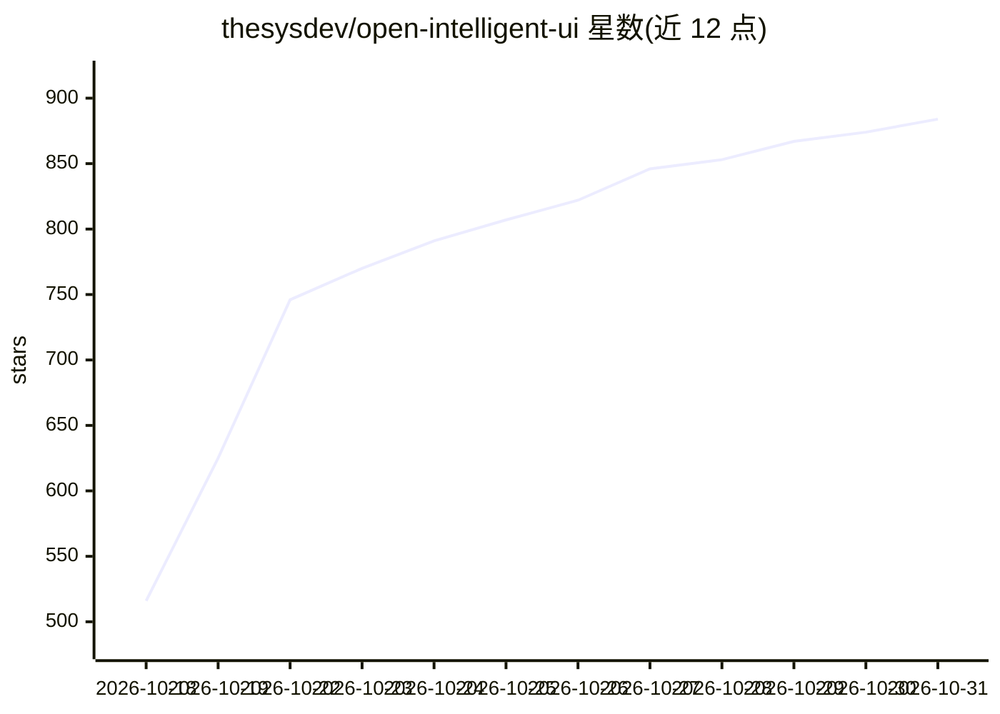

# thesysdev/open-intelligent-ui

⭐ 884 · TypeScript · MIT · 推送 2026-10-29 · [GitHub](https://github.com/thesysdev/open-intelligent-ui) · [官网](https://www.openui.com/demo/intelligent-ui) · 组织维护

**开源复刻 ChatGPT Intelligent UI 的生成式界面示例应用**

基于 OpenUI 标准与 Next.js 的示例应用：模型流式输出 OpenUI Lang，前端用组件原语库（布局、输入、图表、MapLibre 地图、SVG 绘图、沙箱 HTML 等）自排版渲染，配合 59 个 @functions 在页面内计算状态，产出地图、行程、仪表盘等可交互答案而非纯文本。默认经 OpenUI Cloud（Thesys Gateway）生成并校正输出，也可切换任意 OpenAI 兼容 API 或本地 Ollama（无 API key）。面向希望在自家应用中构建同类界面的开发者，含 /gallery 十六个示例程序与基准预览页。

## 筛选速览

| 维度 | 判定 | 备注 |
|---|---|---|
| AI 角色 | `ai-native` | 本体是模型或模型工具 |
| 许可风险 | `permissive` | MIT |
| 部署形态 | `library` | 以包/库形式分发 |
| 模型依赖 | local-ok | 支持本地模型 |
| 硬件要求 | — | 无带数字的原话,不猜 |
| 安装摩擦 | `low` | 无编译、无系统依赖或容器化 |
| 成熟度 | — | 结构信号不足 |

## 能力要点

- 模型流式生成 OpenUI Lang，由约 40 种组件原语自排版渲染为交互式 UI
- 59 个 @functions 让答案在页面内基于 $variables 实时计算
- 支持 OpenUI Cloud、任意 OpenAI 兼容 API 与本地 Ollama 三种模型路径
- SearchImage 经 Wikipedia/Wikimedia Commons 取图，OSRM 提供街道路线

## 适用场景

- 在我的应用里复现 ChatGPT 式的交互式回答体验
- 学习 Generative UI 的组件库、提示词与状态绑定实现
- 用本地 Ollama 模型无 API key 运行生成式界面 demo

## 场景标签

 · 领域:LLM 应用/生成式 UI

## 证据(README 行号)

> L3: **An open-source implementation of the "Intelligent UI" experience introduced in ChatGPT, built on OpenUI.**
> L21: The model streams OpenUI Lang 1.0, and the app renders it with a library of primitives the model arranges itself: n
> L106: - **Generation.** `/api/chat` calls OpenUI Gateway's Responses API with `generateSystemPrompt({ cloud: true })`, s

## 星数曲线

2026-10-18 516 → 2026-10-31 884（+368）

---
*卡片 v1 · prompt 1.4 · 生成 2026-10-21 · 置信度 high · 依据 README sha `e6973df6153f` · [字段定义](../../DATASET.md)*
