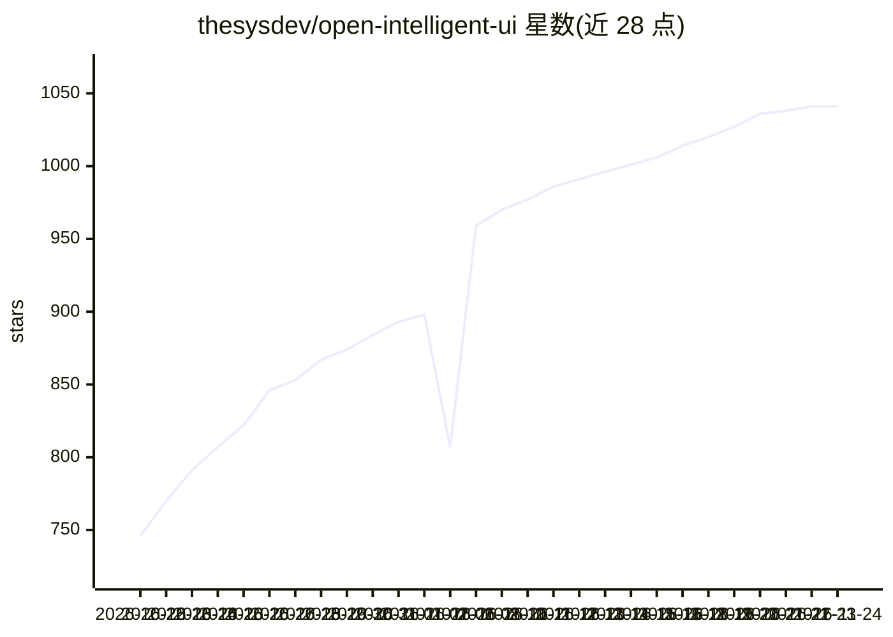

# thesysdev/open-intelligent-ui

⭐ 1,041 · TypeScript · MIT · 推送 2026-11-19 · [GitHub](https://github.com/thesysdev/open-intelligent-ui) · [官网](https://www.openui.com/demo/intelligent-ui) · 组织维护

**开源复刻 ChatGPT 智能界面：回答以交互式 UI 流式呈现**

基于 OpenUI（生成式 UI 开放标准）构建的 Next.js 演示应用，复现 ChatGPT Intelligent UI：模型流式输出 OpenUI Lang 程序，由组件原语（布局、文本、输入、图表、地图、SVG 绘图、HTML 沙盒）渲染为交互式答案，含 59 个 @functions 支持答案内计算与状态绑定。默认经 OpenUI Cloud 网关，也可接任意 OpenAI 兼容 API 或通过 Ollama 跑本地模型。需 Node 24；本地模型建议 32 GB 内存。

## 筛选速览

| 维度 | 判定 | 备注 |
|---|---|---|
| AI 角色 | `ai-native` | 本体是模型或模型工具 |
| 许可风险 | `permissive` | MIT |
| 部署形态 | `library` | 以包/库形式分发 |
| 模型依赖 | local-ok | 支持本地模型 |
| 硬件要求 | — | 无带数字的原话,不猜 |
| 安装摩擦 | `low` | 无编译、无系统依赖或容器化 |
| 成熟度 | — | 结构信号不足 |

## 能力要点

- 模型流式生成 OpenUI Lang，前端以组件原语渲染交互式答案
- 59 个 @functions 与 $variable 状态绑定，答案内可计算与交互
- 支持 OpenUI Cloud、任意 OpenAI 兼容 API 和 Ollama 本地模型三条路径
- /gallery 提供 16 个示例的手写程序用于开发调试

## 适用场景

- 在自己的应用中构建以交互 UI 呈现的 AI 对话界面
- 本地模型离线运行生成式 UI 演示
- 研究 OpenUI Lang 程序与组件库的组织方式

## 场景标签

`聊天机器人` · 领域:对话与助手

## 证据(README 行号)

> L7: In ChatGPT's Intelligent UI, a request such as "plan a day in San Francisco" returns an interactive answer (a map, p
> L21: The model streams OpenUI Lang 1.0, and the app renders it with a library of primitives the model arranges itself: n

## 星数曲线

2026-10-22 746 → 2026-11-24 1,041（+295）

---
*卡片 v1 · prompt 1.4 · 生成 2026-11-24 · 置信度 high · 依据 README sha `3c196c80ca7a` · [字段定义](../../DATASET.md)*
