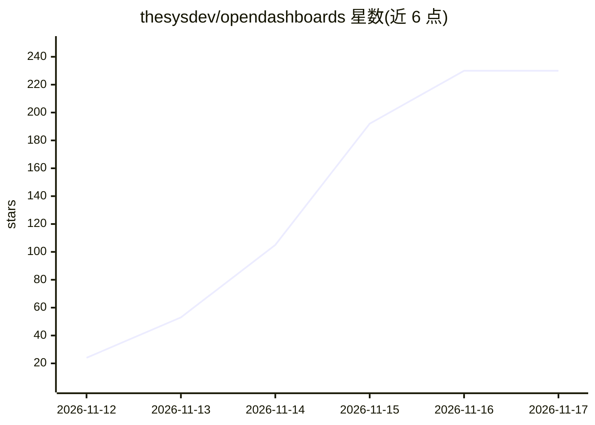

# thesysdev/opendashboards

⭐ 230 · TypeScript · MIT · 推送 2026-11-16 · [GitHub](https://github.com/thesysdev/opendashboards) · [官网](https://opendashboards.com) · 组织维护

**用自然语言提问生成实时数据看板的开源工具**

连接 PostgreSQL、MySQL、BigQuery、PostHog、GA4 等数据源及任意 MCP 服务器后，用户用自然语言提问，由 Build agent 探索数据源并规划，通过 OpenUI Dashboards API 生成可筛选、可下钻的实时交互看板，支持对话式修改单个图表。凭据保存在用户自己的服务器上，可自带 OpenAI 或 Anthropic key。自托管需 Node 20.9+、pnpm、Docker 及 Thesys API key，本地模式密钥不加密且生产环境拒绝该行为；也提供托管版。

## 筛选速览

| 维度 | 判定 | 备注 |
|---|---|---|
| AI 角色 | `ai-native` | 本体是模型或模型工具 |
| 许可风险 | `permissive` | MIT |
| 部署形态 | `library` | 以包/库形式分发 |
| 模型依赖 | — | README 未给出锁定关系 |
| 硬件要求 | — | 无带数字的原话,不猜 |
| 安装摩擦 | `low` | 无编译、无系统依赖或容器化 |
| 成熟度 | — | 结构信号不足 |

## 能力要点

- 自然语言提问生成连接多数据源的实时看板
- 支持 8 类内置数据源连接器及任意远程 MCP 服务器
- BYOK：可自带 OpenAI/Anthropic key，凭据留在自有服务器
- 认证为单一 AuthProvider 接口，可自行实现后部署

## 适用场景

- 把 Stripe、Postgres、HubSpot 等数据汇总成一个可对话修改的看板
- 在自有服务器上部署数据看板，凭据不出内网
- 运营/销售/营销团队用一句话拿到所需指标视图

## 场景标签

`数据分析` · 领域:效率与自动化

## 证据(README 行号)

> L15: Connect your databases and tools, ask a question in plain words, and get a live, interactive
> L92: 2. **Ask** a question. The Build agent explores your sources and plans the dashboard.

## 星数曲线

2026-11-12 24 → 2026-11-17 230（+206）

---
*卡片 v1 · prompt 1.4 · 生成 2026-11-17 · 置信度 mid · 依据 README sha `5e3402021fc7` · [字段定义](../../DATASET.md)*
