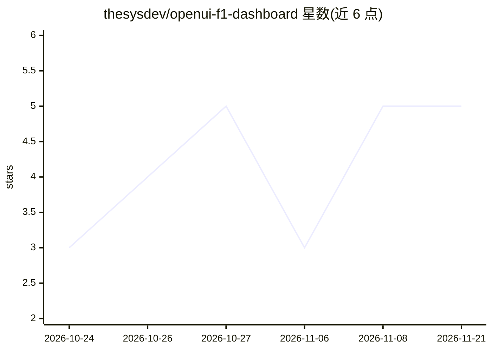

# thesysdev/openui-f1-dashboard

⭐ 5 · TypeScript · 推送 2026-11-20 · [GitHub](https://github.com/thesysdev/openui-f1-dashboard) · [官网](https://www.openui.com/demo/f1-dashboard) · 组织维护

**F1 聊天仪表盘：提问即得实时图表与数据表**

基于 OpenUI、OpenF1 与 Next.js 构建的 Formula 1 演示应用：提供 Home/Standings/Drivers/Teams 四个仪表盘和一个 team radio 聊天，聊天通过 OpenUI Gateway 的 Chat Completions API 调用 F1 工具（比赛结果、单圈时间、积分榜等），答案以 OpenUI Lang 流式渲染为图表与表格。数据来自 OpenF1，带限速客户端与磁盘缓存，可用快照脚本离线运行。需 Node 22.13+，需配置 THESYS_API_KEY。

## 筛选速览

| 维度 | 判定 | 备注 |
|---|---|---|
| AI 角色 | `ai-native` | 本体是模型或模型工具 |
| 许可风险 | `none` | — |
| 部署形态 | `library` | 以包/库形式分发 |
| 模型依赖 | — | README 未给出锁定关系 |
| 硬件要求 | — | 无带数字的原话,不猜 |
| 安装摩擦 | `low` | 无编译、无系统依赖或容器化 |
| 成熟度 | — | 结构信号不足 |

## 能力要点

- 聊天回答以流式图表、表格等生成式 UI 组件呈现
- 工具调用循环：Gateway 选择 F1 工具并实时流式展示结果
- OpenF1 数据带限速客户端与磁盘缓存，支持离线快照
- 图表数据不经过模型，由组件自行从 /api/f1/[tool] 获取

## 适用场景

- 用自然语言查询 F1 比赛结果与积分榜并看到图表
- 作为生成式 UI 的参考实现部署自己的聊天仪表盘
- 离线缓存历史 F1 赛季后在无网环境运行工具查询

## 场景标签

`数据分析` · 领域:效率与自动化

## 证据(README 行号)

> L3: A Formula 1 demo built on OpenUI: a "team radio" chat that answers with live charts, tables and F1 visuals, alongsid
> L42: 3. Gateway's Chat Completions API picks F1 tools (`get_results`, `get_lap_times`, `get_standings`, …). The route ru
> L43: 4. The answer streams back as OpenUI Lang and renders as it arrives, with the F1 component library (`src/library.ts

## 星数曲线

2026-10-24 3 → 2026-11-21 5（+2）

---
*卡片 v1 · prompt 1.4 · 生成 2026-11-21 · 置信度 high · 依据 README sha `eb06cfed0d76` · [字段定义](../../DATASET.md)*
