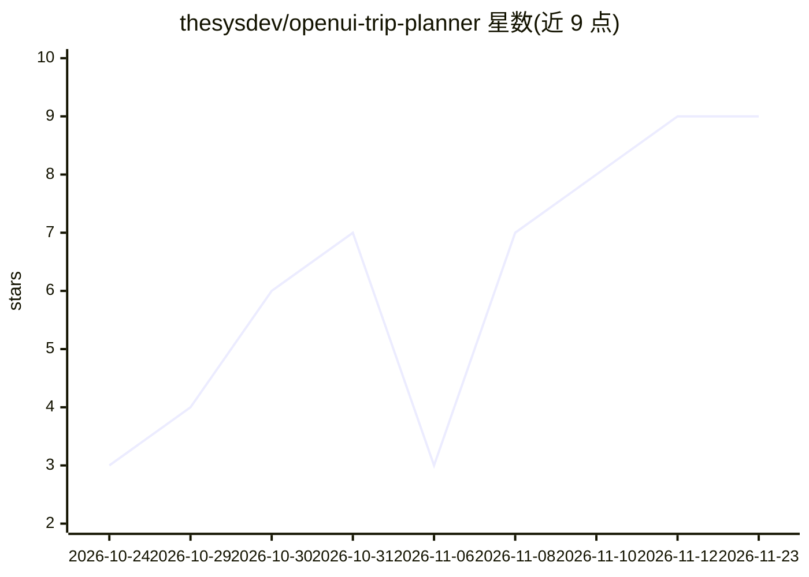

# thesysdev/openui-trip-planner

⭐ 9 · TypeScript · 推送 2026-11-16 · [GitHub](https://github.com/thesysdev/openui-trip-planner) · [官网](https://www.openui.com/demo/trip-planner) · 组织维护

**对话式生成行程界面的 AI 旅行规划 Web 应用**

基于 OpenUI 构建的旅行规划应用：用户描述行程后得到的是界面（灵感图板、对话、按日行程板与地图）而非纯文本。前端流式渲染 OpenUI Lang 组件，服务端通过 OpenUI Gateway 的 Chat Completions API 调用模型，并在补全间执行自有工具 search_stays 调 trivago 公共 MCP 服务器获取酒店价格与预订链接。行程数据存于浏览器 localStorage，无登录。需 Node 22.13+ 与 THESYS_API_KEY，可本地运行或部署。

## 筛选速览

| 维度 | 判定 | 备注 |
|---|---|---|
| AI 角色 | `ai-native` | 本体是模型或模型工具 |
| 许可风险 | `none` | — |
| 部署形态 | `library` | 以包/库形式分发 |
| 模型依赖 | — | README 未给出锁定关系 |
| 硬件要求 | — | 无带数字的原话,不猜 |
| 安装摩擦 | `low` | 无编译、无系统依赖或容器化 |
| 成熟度 | — | 结构信号不足 |

## 能力要点

- 对话中流式生成界面组件（moodboard/聊天/行程板）
- search_stays 工具经 MCP SDK 调 trivago 公共 MCP 服务器，酒店价格来自 trivago
- 地图、地点、天气、汇率、照片使用多个免密钥公共服务（OpenFreeMap/Nominatim/Open-Meteo 等）
- 无状态路由、数据存浏览器 localStorage，POST 路由有来源校验

## 适用场景

- 和 AI 聊着探索目的地并把收藏地点变成按日行程
- 在地图行程板上查看酒店实时价格
- 自部署一个生成式界面风格的旅行助手 demo

## 场景标签

`AI 助手` · 领域:对话与助手

## 证据(README 行号)

> L3: An AI trip planner built with OpenUI: describe a trip and its answers are interfaces, not text. Explore ideas, chat 
> L35: The planner streams OpenUI Lang from OpenUI Gateway's Chat Completions API and renders it with its component librar
> L37: Between completions the server runs app-owned tools; the main one, `search_stays`, calls trivago's public MCP serve

## 星数曲线

2026-10-24 3 → 2026-11-23 9（+6）

---
*卡片 v1 · prompt 1.4 · 生成 2026-11-20 · 置信度 high · 依据 README sha `cf81719ae41b` · [字段定义](../../DATASET.md)*
