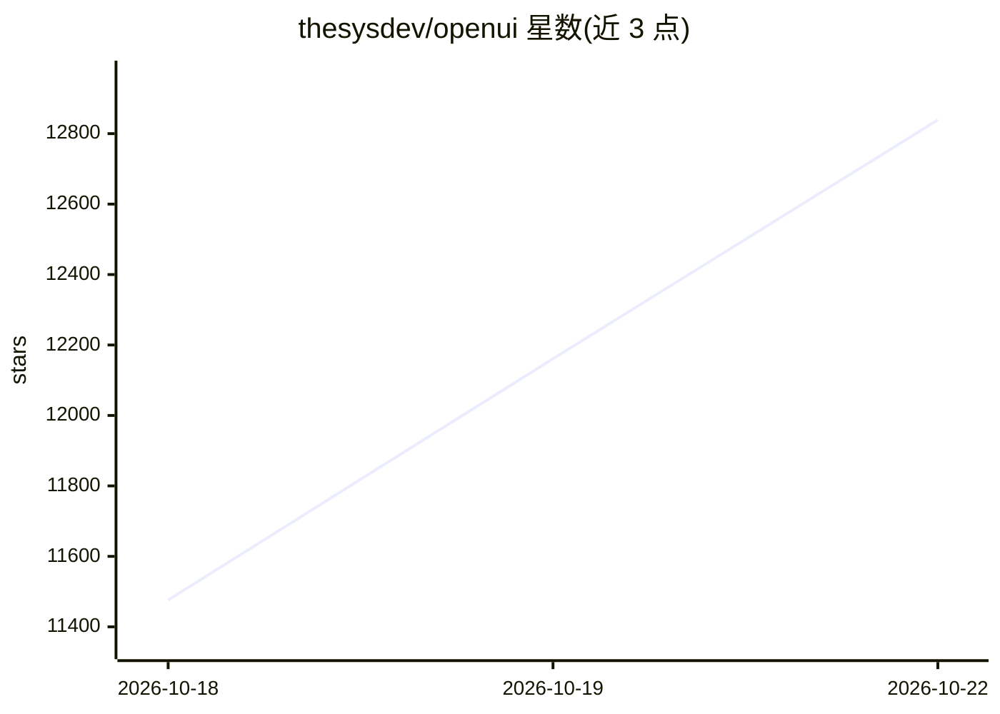

# thesysdev/openui

⭐ 12,839 · TypeScript · MIT · 推送 2026-10-19 · [GitHub](https://github.com/thesysdev/openui) · [官网](https://www.openui.com) · 组织维护

**面向开发者的生成式 UI 框架：以流式语言渲染模型输出为界面**

由 Thesys 维护的全栈、框架无关的 Generative UI 框架，核心是 OpenUI Lang——一种面向模型生成 UI 的紧凑流式语言，README 称比等效 JSON 少用至多 67% token。机制为：从开发者定义的组件库生成系统提示，发送给任意模型，再将流式输出渐进渲染为 React/Vue/Svelte/Angular 界面。以 npm 包矩阵形式提供（含 CLI 脚手架、聊天 UI、可观测性组件），并有 Agent Skill 供 AI 编程助手使用。

## 筛选速览

| 维度 | 判定 | 备注 |
|---|---|---|
| AI 角色 | `ai-ecosystem` | LLM/agent 周边工具 |
| 许可风险 | `permissive` | MIT |
| 部署形态 | `library` | 以包/库形式分发 |
| 模型依赖 | — | README 未给出锁定关系 |
| 硬件要求 | — | 无带数字的原话,不猜 |
| 安装摩擦 | `low` | 无编译、无系统依赖或容器化 |
| 成熟度 | — | 结构信号不足 |

## 能力要点

- OpenUI Lang 流式语言，README 称最多省 67% token
- React/Vue/Svelte/Angular 四个运行时
- 组件库驱动提示生成与受限渲染
- 内置图表/表单/表格等组件库与聊天界面

## 适用场景

- 为 AI 助手/copilot 产品构建可流式渲染的界面
- 用自有组件库约束模型可生成的 UI 范围
- 快速脚手架一个端到端生成式 UI 聊天应用

## 场景标签

 · 领域:前端/LLM 应用框架

## 证据(README 行号)

> L18: OpenUI is a full-stack, framework-agnostic Generative UI framework built around a compact, streaming-first language
> L28: At the center of OpenUI is **OpenUI Lang**: a compact, streaming-first language for model-generated UI. Instead of 
> L79: |`@openuidev/langchain`|LangChain and LangGraph agents|Agent transformer and server helpers that stream OpenUI thro

## 星数曲线

2026-10-18 11,476 → 2026-10-22 12,839（+1,363）

---
*卡片 v1 · prompt 1.4 · 生成 2026-10-20 · 置信度 high · 依据 README sha `d65ef178bec3` · [字段定义](../../DATASET.md)*
