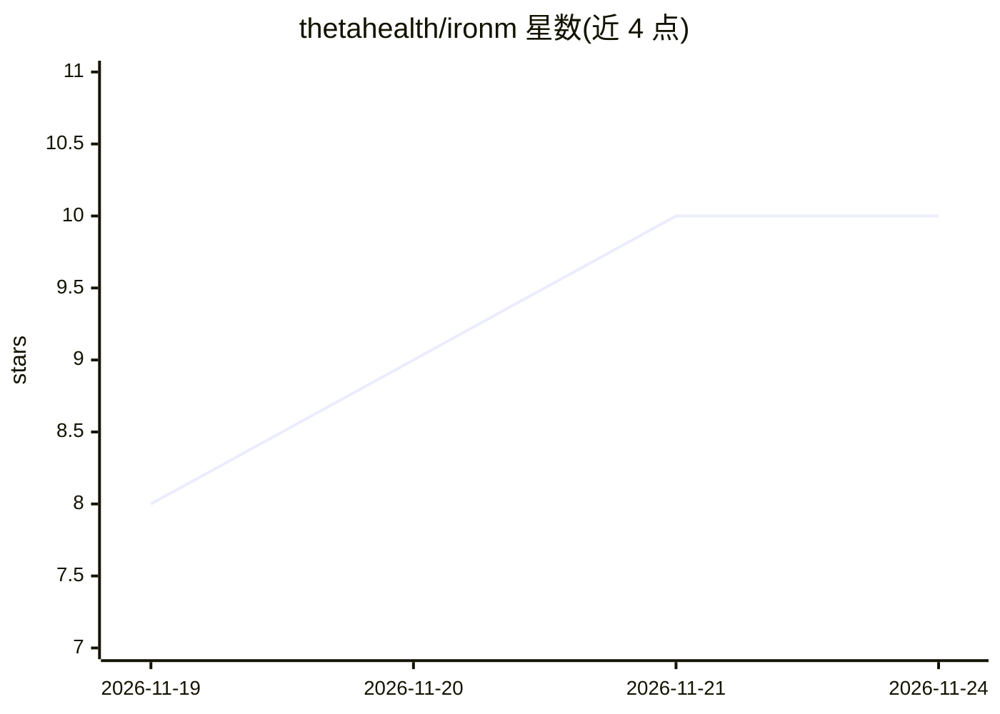

# thetahealth/ironm

⭐ 10 · Python · Apache-2.0 · 推送 2026-11-20 · [GitHub](https://github.com/thetahealth/ironm) · [官网](https://ironm.mirobody.ai) · 组织维护 · 中文 README

**面向健身用户的 AI 教练：整合训练、饮食、睡眠数据给出个性化方案**

基于 Mirobody 健康数据引擎构建的 AI 健身教练应用：读取睡眠、心率、实验室报告、Apple Health 与穿戴设备数据，结合用户的伤病、器材与训练记录，生成训练计划、调整当日负荷、计算卡路里目标与饮食安排。摄像头动作纠正覆盖 71 个动作并自动计数，视频不离开手机。所有计划与热量修改以预览卡形式呈现，用户确认后才生效且可撤销；热量修改在代码中设有下限限制。应用界面与教练回复目前为中文，可在线使用或自部署，支持自带 LLM。

## 筛选速览

| 维度 | 判定 | 备注 |
|---|---|---|
| AI 角色 | `ai-native` | 本体是模型或模型工具 |
| 许可风险 | `permissive` | Apache-2.0 |
| 部署形态 | `self-host` | docker 或自建部署 |
| 模型依赖 | — | README 未给出锁定关系 |
| 硬件要求 | — | 无带数字的原话,不猜 |
| 安装摩擦 | `low` | 无编译、无系统依赖或容器化 |
| 成熟度 | — | 结构信号不足 |

## 能力要点

- 摄像头 AI 动作纠正覆盖 71 个动作，自动计数并语音提示，视频不离开手机
- 整合睡眠、心率、实验室报告与训练记录做当日训练决策
- 所有计划与热量修改先出预览卡，确认后生效且可撤销
- 热量目标在代码中设硬限制：不低于 BMR、单次改动不超 300 kcal

## 适用场景

- 根据睡眠和心率数据决定当天按计划训练、减量还是休息
- 出差或生病期间生成临时训练计划并自动恢复
- 拍照或一句话记录一餐的卡路里与蛋白质
- 跟随健身创作者视频生成适配自身器材的跟练计划

## 场景标签

 · 领域:健康/健身消费应用

## 证据(README 行号)

> L5: **The AI fitness coach that sees all your data**
> L15: Open source · Use it online or run it yourself · Uses your own LLM
> L55: **So we built IronM on it.** A fitness coach that sees your training, food, sleep, heart rate and lab results, and 

## 星数曲线

2026-11-19 8 → 2026-11-24 10（+2）

---
*卡片 v1 · prompt 1.4 · 生成 2026-11-20 · 置信度 high · 依据 README sha `0be3f9140a2a` · [字段定义](../../DATASET.md)*
