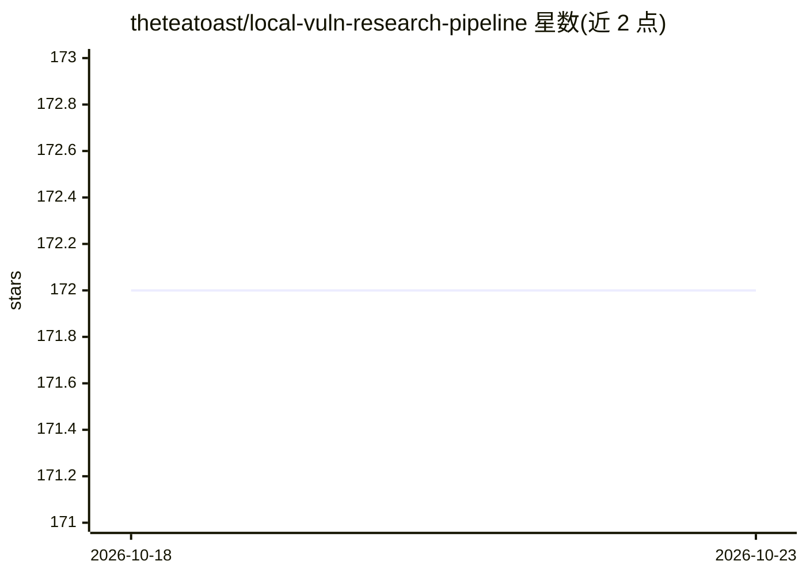

# theteatoast/local-vuln-research-pipeline

⭐ 172 · Python · 推送 2026-09-05 · [GitHub](https://github.com/theteatoast/local-vuln-research-pipeline) · 个人维护

**本地 LLM 驱动的白盒漏洞研究管线，穷举源到污点汇聚点路径**

面向安全研究者的代码审计工具：对 16 种语言的源码做确定性解析，构建全量调用图，标注不可信输入源与危险操作汇聚点，穷举所有 source-to-sink 路径并做过程内/间污点追踪，仅将模糊路径交由本地 LLM（Qwen2.5-Coder-14B，经 llama.cpp 服务）验证可利用性；未被路径覆盖的文件另做逐文件盲区审查。5 个内存分析器处理 C/C++/Rust 内存破坏问题，用 networkx 合成多步利用链，注入 CVE 模式辅助匹配。给出实测硬件配置（16GB VRAM GPU、32GB RAM）与已知静态分析局限。

## 筛选速览

| 维度 | 判定 | 备注 |
|---|---|---|
| AI 角色 | `ai-native` | 本体是模型或模型工具 |
| 许可风险 | `none` | — |
| 部署形态 | `library` | 以包/库形式分发 |
| 模型依赖 | local-ok | 支持本地模型 |
| 硬件要求 | `gpu-8g` | |
| 安装摩擦 | `low` | 无编译、无系统依赖或容器化 |
| 成熟度 | — | 结构信号不足 |

## 能力要点

- 穷举所有 source-to-sink 调用图路径，LLM 只做可利用性验证
- 覆盖注入、反序列化、内存破坏、路径遍历等多类漏洞与 16 种语言
- 逐文件盲区红队审查覆盖路径分析未触及的源码
- networkx 传递闭包合成最多 50 条多步利用链，含 PoC 步骤与修复建议

## 适用场景

- 对企业级代码库做白盒漏洞审计并生成含 PoC 的报告
- 审计 C/C++/Rust 代码的内存破坏问题
- 离线/本地环境下进行漏洞研究，无需云端 API

## 场景标签

`代码审查` · 领域:编码与开发

## 证据(README 行号)

> L19: 7. Validates ambiguous paths with LLM for genuine exploitability
> L37: The code graph is built deterministically. The LLM is used only for exploitability reasoning on pre-traced paths, n

## 星数曲线

2026-10-18 172 → 2026-10-23 172（+0）

---
*卡片 v1 · prompt 1.4 · 生成 2026-10-22 · 置信度 high · 依据 README sha `6f3d7593146d` · [字段定义](../../DATASET.md)*
