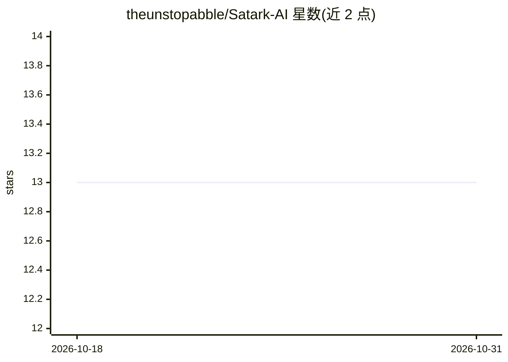

# theunstopabble/Satark-AI

⭐ 13 · JavaScript · 推送 2026-10-18 · [GitHub](https://github.com/theunstopabble/Satark-AI) · [官网](https://satark-deepfake.vercel.app/) · 个人维护

**全栈深度伪造检测与说话人声纹验证平台**

Turborepo 微服务单仓库构建的 Web 平台，覆盖音频、图像、视频三类输入：音频侧用 Wav2Vec2 加 MFCC/频谱/过零率多特征融合检测合成语音；图像侧经 Cloudflare Worker 代理调用 Hugging Face Inference API 上的两个检测模型；声纹侧用 SpeechBrain ECAPA-TDNN 提取 192 维嵌入并按余弦相似度（阈值 0.75）验证说话人身份。前端为 React PWA，含实时麦克风监测、分析看板与 PDF 报告导出。部署依赖 Node.js、Python 3.11 与 PostgreSQL，提供 Vercel/Render/Docker 部署文档。

## 筛选速览

| 维度 | 判定 | 备注 |
|---|---|---|
| AI 角色 | `ai-native` | 本体是模型或模型工具 |
| 许可风险 | `none` | — |
| 部署形态 | `self-host` | docker 或自建部署 |
| 模型依赖 | — | README 未给出锁定关系 |
| 硬件要求 | — | 无带数字的原话,不猜 |
| 安装摩擦 | `low` | 无编译、无系统依赖或容器化 |
| 成熟度 | — | 结构信号不足 |

## 能力要点

- Wav2Vec2 + 频谱/过零率多特征融合的音频深度伪造检测
- ECAPA-TDNN 192 维声纹嵌入与余弦相似度（0.75 阈值）说话人验证
- Cloudflare Worker 代理 Hugging Face Inference API 的图像检测管线
- 实时麦克风 5 秒分块监测与扫描历史 PDF 报告导出

## 适用场景

- 上传音频/视频/图片判断是否为 AI 生成内容
- 注册参考声样后验证未知语音的说话人身份
- 实时监测麦克风输入并标记合成语音

## 场景标签

`网络安全` `图像视频处理` · 领域:学习与行业

## 证据(README 行号)

> L22: **Satark-AI** is a production-grade, full-stack **deepfake detection and speaker verification platform**. Built as 
> L38: - **Wav2Vec2 Model**: Transformer-based deep learning model fine-tuned for synthetic speech detection.
> L60: - **Enrollment System**: Enroll a speaker by uploading a reference audio sample. ECAPA-TDNN extracts a 192-dim voic

## 星数曲线

2026-10-18 13 → 2026-10-31 13（+0）

---
*卡片 v1 · prompt 1.4 · 生成 2026-10-31 · 置信度 mid · 依据 README sha `d7a16b8b7be6` · [字段定义](../../DATASET.md)*
