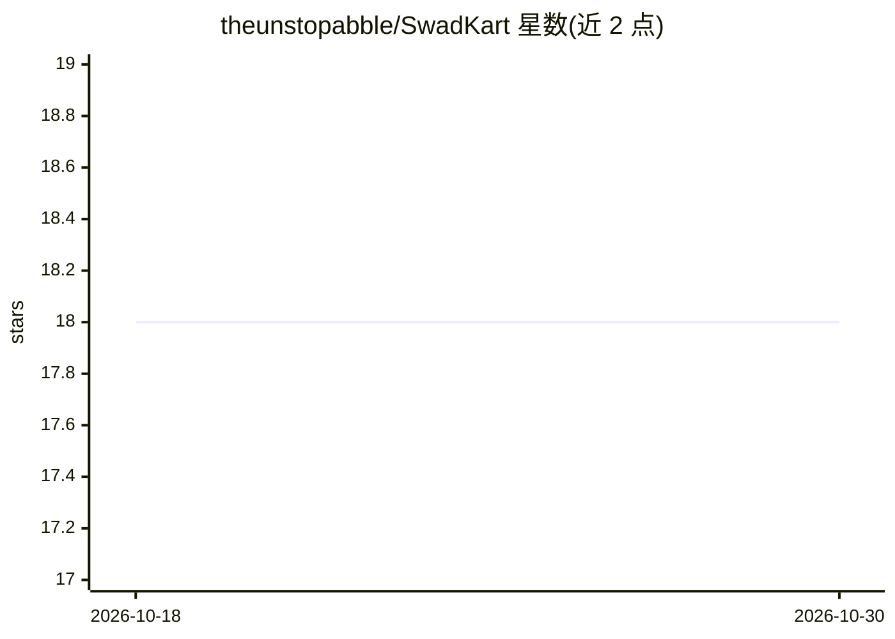

# theunstopabble/SwadKart

⭐ 18 · JavaScript · 推送 2026-10-16 · [GitHub](https://github.com/theunstopabble/SwadKart) · [官网](https://swadkart.vercel.app) · 个人维护

**多商户外卖平台（MERN），含 AI 聊天机器人等 AI 功能**

基于 MERN 栈的多商户外卖平台，含四种角色（管理员/商家/骑手/顾客）：实时 GPS 骑手跟踪（Socket.io）、WebAuthn 生物识别登录、Razorpay 支付（UPI/卡/钱包/COD）、Razorpay 订阅、游戏化积分、PWA 离线支持、Redis 缓存与安全措施（限流/CSRF/NoSQL 注入防护等）。AI 部分：接入 Groq（Llama 3）的聊天机器人做自然语言菜品推荐，通过 function-calling 执行查订单/取消/重下单等动作，另有英文/印地语语音搜索。运行需 Node.js v18+、MongoDB、Firebase 项目，前后端分别 npm 安装启动。

## 筛选速览

| 维度 | 判定 | 备注 |
|---|---|---|
| AI 角色 | `ai-enhanced` | 去掉 AI 部分产品仍成立 |
| 许可风险 | `none` | — |
| 部署形态 | `library` | 以包/库形式分发 |
| 模型依赖 | locked-api |  |
| 硬件要求 | — | 无带数字的原话,不猜 |
| 安装摩擦 | `low` | 无编译、无系统依赖或容器化 |
| 成熟度 | — | 结构信号不足 |

## 能力要点

- Groq LLM 聊天机器人，经 function-calling 执行订单状态/取消/重下单/优惠券等动作
- Socket.io 实时 GPS 骑手跟踪与 ETA 预测
- WebAuthn 指纹/FaceID 登录 + JWT + Firebase OAuth 三重认证
- PWA 可安装，支持离线缓存与推送通知

## 适用场景

- 搭建多商户外卖订餐与配送平台
- 为顾客提供自然语言菜品推荐与语音搜索
- 管理商家菜单、骑手配送、优惠券与订单分析

## 场景标签

`聊天机器人` · 领域:对话与助手

## 证据(README 行号)

> L49: **SwadKart** is a production-grade, scalable multi-vendor food delivery platform built with the **MERN stack** (Mon
> L54: - 🤖 **AI-Powered** — Groq LLM chatbot for natural language food recommendations
> L65: - **Smart Discovery** — AI-powered restaurant & dish recommendations with natural language search

## 星数曲线

2026-10-18 18 → 2026-10-30 18（+0）

---
*卡片 v1 · prompt 1.4 · 生成 2026-10-29 · 置信度 high · 依据 README sha `ccd289b9f713` · [字段定义](../../DATASET.md)*
