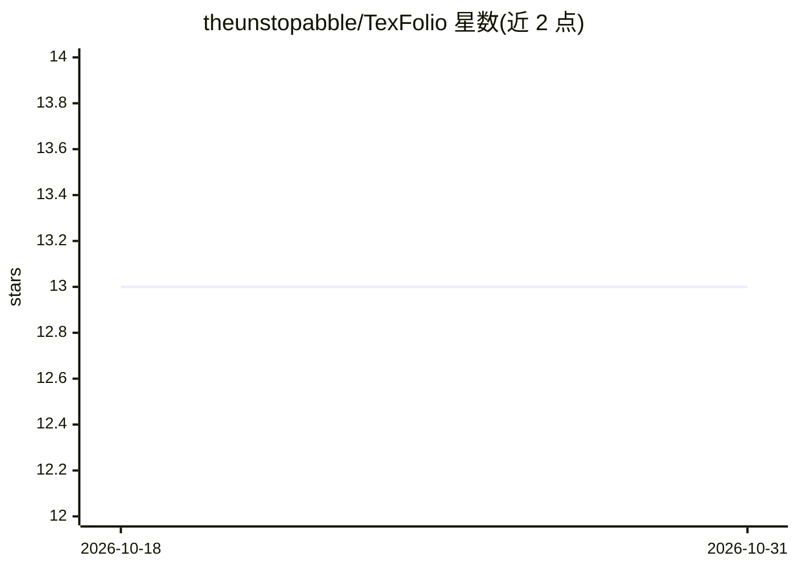

# theunstopabble/TexFolio

⭐ 13 · TypeScript · 推送 2026-10-18 · [GitHub](https://github.com/theunstopabble/TexFolio) · [官网](https://texfolio.vercel.app) · 个人维护

**AI 辅助的 LaTeX 简历构建 SaaS，产出 ATS 友好 PDF**

TexFolio 是一个面向求职者的简历构建 SaaS：后端用 pdflatex（Docker 容器或本地 MiKTeX）编译真实 LaTeX 生成 PDF，提供 FAANG 风格模板、拖拽编辑器与实时预览。AI 功能包括 LangGraph 多 agent 简历教练（内容/影响力/格式/ATS 四维评分）、要点生成器、求职信生成与 LinkedIn PDF 导入（Llama 3.3），LLM 供应商为 NVIDIA NIM 主用、Groq/Gemini 兜底。还包含多组织 RBAC、BullMQ 异步 PDF 生成、Razorpay 支付与 GDPR 数据导出/删除接口。技术栈为 React + Hono + MongoDB + Redis，需 Node.js >= 18 及多个外部 API key 方可本地运行。

## 筛选速览

| 维度 | 判定 | 备注 |
|---|---|---|
| AI 角色 | `ai-enhanced` | 去掉 AI 部分产品仍成立 |
| 许可风险 | `none` | — |
| 部署形态 | `library` | 以包/库形式分发 |
| 模型依赖 | locked-api |  |
| 硬件要求 | — | 无带数字的原话,不猜 |
| 安装摩擦 | `low` | 无编译、无系统依赖或容器化 |
| 成熟度 | — | 结构信号不足 |

## 能力要点

- pdflatex 真实编译生成 PDF（Docker 容器化）
- LangGraph 多 agent 简历教练，输出 0-100 ATS 评分
- BullMQ + Redis 异步 PDF 生成，带进度跟踪与重试
- 多组织 RBAC（Owner/Admin/Editor/Viewer）与 GDPR 导出/删除接口

## 适用场景

- 构建 ATS 友好、LaTeX 排版的简历并获得 AI 评分反馈
- 团队共享简历模板并按角色控制访问权限
- 基于简历与职位描述自动生成求职信

## 场景标签

`AI 写作` · 领域:内容生成

## 证据(README 行号)

> L19: **TexFolio** is a modern SaaS application that combines the precision of LaTeX document rendering with the intellig
> L27: - **LangGraph Resume Coach:** Multi-agent pipeline scoring Content, Impact, Format, and ATS compatibility.
> L36: - **Real LaTeX Rendering:** Uses `pdflatex` to compile high-quality PDFs.

## 星数曲线

2026-10-18 13 → 2026-10-31 13（+0）

---
*卡片 v1 · prompt 1.4 · 生成 2026-10-31 · 置信度 high · 依据 README sha `5fd2a1ed38cb` · [字段定义](../../DATASET.md)*
