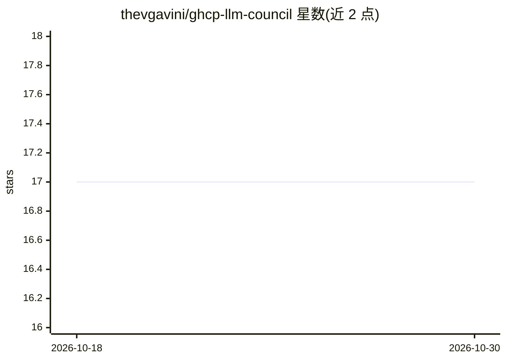

# thevgavini/ghcp-llm-council

⭐ 17 · JavaScript · NOASSERTION · 推送 2026-05-30 · [GitHub](https://github.com/thevgavini/ghcp-llm-council) · 个人维护

**Copilot CLI 多模型合议技能：五模型辩论加主席综合**

GitHub Copilot CLI 的技能（插件）：将用户问题分派给五个模型（Claude Sonnet、GPT-5.2、Llama 3.3、DeepSeek V3、Mistral Medium）并行作答，执行同行评审与匿名排名，再由 Claude Opus 主席综合出最终回答。推理走 Copilot 订阅的 task 后端或 gh auth token 的 GitHub Models 后端，无需额外 API key。提供本地 Web UI 实时展示各阶段，支持 general/review/design/plan/research 五种模式、追问与文件上下文，配置可按项目覆盖委员会阵容。要求 Node 20+ 与 GitHub Copilot CLI。

## 筛选速览

| 维度 | 判定 | 备注 |
|---|---|---|
| AI 角色 | `ai-ecosystem` | LLM/agent 周边工具 |
| 许可风险 | `none` | NOASSERTION |
| 部署形态 | `library` | 以包/库形式分发 |
| 模型依赖 | — | README 未给出锁定关系 |
| 硬件要求 | — | 无带数字的原话,不猜 |
| 安装摩擦 | `low` | 无编译、无系统依赖或容器化 |
| 成熟度 | — | 结构信号不足 |

## 能力要点

- 五议员模型并行作答 + 同行评审 + 匿名排名 + 主席综合的三阶段合议
- 零额外凭证：复用 Copilot 订阅与 gh auth token 两种推理路径
- 本地 Web UI 实时展示合议全过程
- 五种模式（review/design/plan/research 等）各配调优提示词，委员会阵容可配置

## 适用场景

- 在 Copilot CLI 中对架构或选型问题获取多模型交叉评审的答案
- 让多个模型对代码做安全审查并互相批评
- 对既有对话线程发起后续合议深入追问

## 场景标签

`多智能体` · 领域:Agent 开发

## 证据(README 行号)

> L17: LLM Council is a **skill** (plugin) for GitHub Copilot CLI. Instead of getting one model's opinion, you get a struc
> L53: Two inference paths, zero extra credentials:

## 星数曲线

2026-10-18 17 → 2026-10-30 17（+0）

---
*卡片 v1 · prompt 1.4 · 生成 2026-10-29 · 置信度 high · 依据 README sha `04fadf62b006` · [字段定义](../../DATASET.md)*
