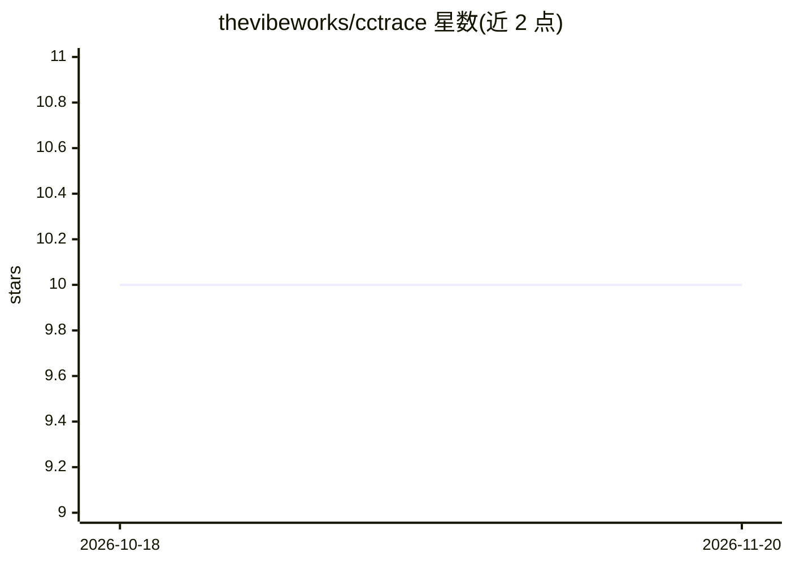

# thevibeworks/cctrace

⭐ 10 · TypeScript · MIT · 推送 2026-10-05 · [GitHub](https://github.com/thevibeworks/cctrace) · [官网](https://thevibeworks.github.io/cctrace) · 组织维护 · 中文 README

**TLS 拦截追踪器：可视化排查编码 Agent 的 API 流量与会话**

以本地 TLS 拦截代理记录 Claude Code、Codex、Grok、Kimi Code、opencode 等编码 CLI 的 API 流量，在本地 Web UI 中重建为可浏览会话：回放会话、检索会话内容、查看上下文中的指令与工具结果、统计每轮的 token/缓存/成本/延迟，并提供跨项目用量面板。第一方流量解密捕获，凭据字段在存储前脱敏，捕获数据不上传，仅保存本地。需 Bun 与 openssl，经 npm 全局安装。

## 筛选速览

| 维度 | 判定 | 备注 |
|---|---|---|
| AI 角色 | `ai-ecosystem` | LLM/agent 周边工具 |
| 许可风险 | `permissive` | MIT |
| 部署形态 | `library` | 以包/库形式分发 |
| 模型依赖 | — | README 未给出锁定关系 |
| 硬件要求 | — | 无带数字的原话,不猜 |
| 安装摩擦 | `low` | 无编译、无系统依赖或容器化 |
| 成熟度 | — | 结构信号不足 |

## 能力要点

- 本地 TLS 拦截代理捕获 Agent API 流量，含模型调用之外的第一方请求
- Web UI 提供会话重建、回放与会话内检索
- 按轮次统计成本、缓存命中率与延迟，支持跨项目扫描（insights --scan）
- 凭据字段存储前脱敏，捕获仅存本地不上传

## 适用场景

- 排查编码 Agent 会话中上下文窗口被什么填满
- 分析工具调用与子 Agent 的执行过程并回放
- 跨多个项目审计 Agent 的用量与缓存行为
- 将 Agent 会话导出为 Markdown 归档

## 场景标签

`LLM 可观测性` · 领域:评测与运维

## 证据(README 行号)

> L16: cctrace records your coding agent's API traffic and turns it into a local,
> L49: cctrace runs a local TLS-intercepting proxy. First-party hosts are decrypted;

## 星数曲线

2026-10-18 10 → 2026-11-20 10（+0）

---
*卡片 v1 · prompt 1.4 · 生成 2026-11-19 · 置信度 high · 依据 README sha `0e87b1862c04` · [字段定义](../../DATASET.md)*
