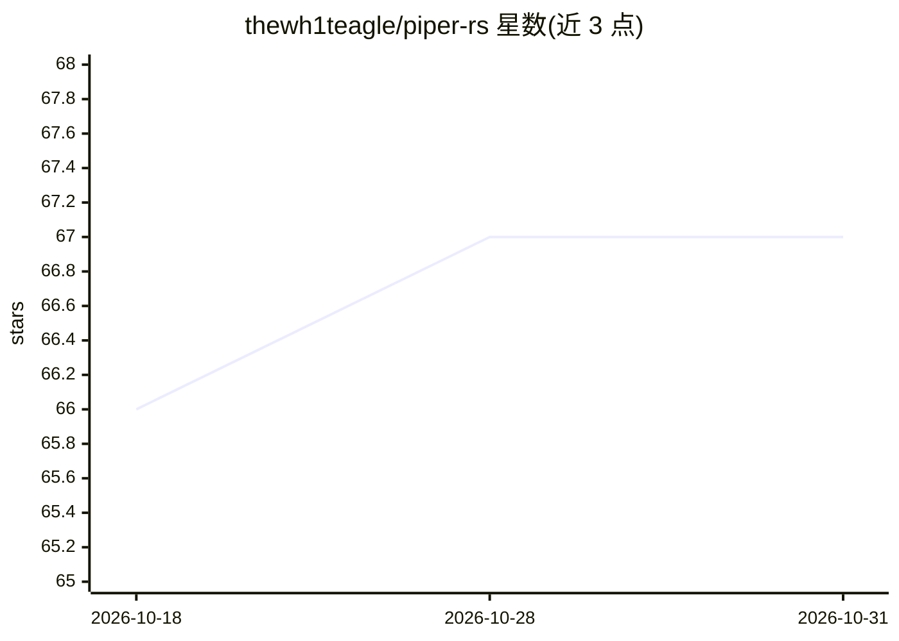

# thewh1teagle/piper-rs

⭐ 67 · Rust · 推送 2026-05-21 · [GitHub](https://github.com/thewh1teagle/piper-rs) · [官网](https://crates.io/crates/piper-rs) · 个人维护

**Rust 库：在 Rust 中运行 Piper TTS 语音合成模型**

提供纯 Rust 实现的 Piper TTS 推理 crate，兼容所有 Piper TTS 模型并支持多语言，基于 ONNX Runtime 执行 VITS 语音合成。预训练模型托管在 Hugging Face 的 rhasspy/piper-voices。通过 cargo add piper-rs 安装，README 另指向 examples 目录；项目受 sonata（mush42 创建）启发。README 篇幅较短，未说明 API 细节与性能指标。

## 筛选速览

| 维度 | 判定 | 备注 |
|---|---|---|
| AI 角色 | `ai-native` | 本体是模型或模型工具 |
| 许可风险 | `none` | — |
| 部署形态 | `None` |  |
| 模型依赖 | — | README 未给出锁定关系 |
| 硬件要求 | — | 无带数字的原话,不猜 |
| 安装摩擦 | `low` | 无编译、无系统依赖或容器化 |
| 成熟度 | — | 结构信号不足 |

## 能力要点

- 兼容所有 Piper TTS 模型
- 支持多语言语音合成
- 纯 Rust 实现

## 适用场景

- 在 Rust 应用中集成离线 TTS 语音合成
- 复用 Hugging Face 上的 Piper 预训练模型生成语音

## 场景标签

`语音合成` · 领域:内容生成

## 证据(README 行号)

> L5: Use Piper TTS models in Rust.
> L9: - Compatibility with all Piper TTS models

## 星数曲线

2026-10-18 66 → 2026-10-31 67（+1）

---
*卡片 v1 · prompt 1.4 · 生成 2026-10-24 · 置信度 high · 依据 README sha `1f50dabfcf43` · [字段定义](../../DATASET.md)*
