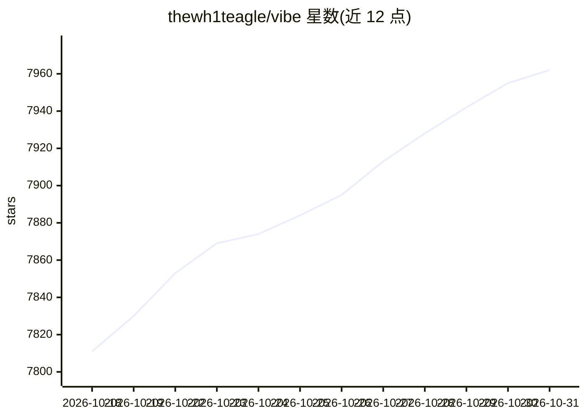

# thewh1teagle/vibe

⭐ 7,962 · TypeScript · MIT · 推送 2026-10-30 · [GitHub](https://github.com/thewh1teagle/vibe) · [官网](https://thewh1teagle.github.io/vibe/) · 个人维护

**离线本地语音转录桌面应用：音频视频转文字与摘要**

基于 Tauri 与 whisper.cpp 的跨平台（macOS/Windows/Linux）桌面转录应用：在设备本地离线转录音频和视频文件，支持几乎所有语言、批量转录、实时预览、说话人分离、字幕级稳定时间戳，输出 SRT/VTT/TXT/HTML/PDF/JSON/DOCX 格式。可转录系统音频、麦克风，以及通过扫码从手机录音回传转录。支持 Whisper、Nemotron 3.5、Parakee TDT v3 模型，优化 Nvidia/AMD/Intel GPU（Vulkan/CoreML）。附加功能：Claude API 摘要、Ollama 本地分析、HTTP API 与 CLI。官网提供下载安装包，面向普通用户与开发者。

## 筛选速览

| 维度 | 判定 | 备注 |
|---|---|---|
| AI 角色 | `ai-native` | 本体是模型或模型工具 |
| 许可风险 | `permissive` | MIT |
| 部署形态 | `None` |  |
| 模型依赖 | local-ok | 支持本地模型 |
| 硬件要求 | — | 无带数字的原话,不猜 |
| 安装摩擦 | `low` | 无编译、无系统依赖或容器化 |
| 成熟度 | — | 结构信号不足 |

## 能力要点

- 完全离线的设备本地转录，数据不离开设备
- 支持 Whisper、Nemotron 3.5、Parakeet TDT v3 多模型，GPU 加速（Vulkan/CoreML）
- 输出 SRT/VTT/TXT/HTML/PDF/JSON/DOCX 多格式，支持批量转录与说话人分离
- 提供 CLI、HTTP API（含 Swagger 文档与 agent skills）与手机扫码录音回传

## 适用场景

- 给本地音频视频文件离线生成字幕或文字稿，保护隐私
- 批量转录会议录音、播客或在线视频（YouTube/Vimeo 等）
- 转录后用 Claude API 或本地 Ollama 生成多语言摘要
- 通过命令行或 HTTP API 集成到自动化转录流程

## 场景标签

`语音识别` · 领域:感知与多模态

## 证据(README 行号)

> L11:  ⌨️ Transcribe audio and video right on your device
> L37: - 🤖 Supports Whisper, Nemotron 3.5, and Parakeet TDT v3 models

## 星数曲线

2026-10-18 7,811 → 2026-10-31 7,962（+151）

---
*卡片 v1 · prompt 1.4 · 生成 2026-10-20 · 置信度 high · 依据 README sha `41233cca2008` · [字段定义](../../DATASET.md)*
