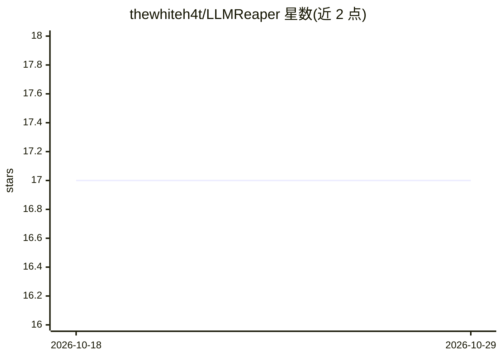

# thewhiteh4t/LLMReaper

⭐ 17 · JavaScript · MIT · 推送 2026-05-27 · [GitHub](https://github.com/thewhiteh4t/LLMReaper) · 个人维护

**被动捕获 LLM 对话并检测敏感数据泄露的安全研究 PoC**

由 thewhiteh4t 发布的概念验证安全研究项目：Chromium MV3 浏览器扩展利用标准 DOM 访问，实时捕获 ChatGPT/Claude/Gemini 平台上的对话并发送至 FastAPI 后端；后端用正则匹配检测 API 密钥、认证令牌、云凭据、PII、连接字符串等敏感数据。仅限安全研究与防御性意识用途，提供未打包扩展加载方式与 Arch/Debian/pip 依赖安装说明。

## 筛选速览

| 维度 | 判定 | 备注 |
|---|---|---|
| AI 角色 | `ai-ecosystem` | LLM/agent 周边工具 |
| 许可风险 | `permissive` | MIT |
| 部署形态 | `library` | 以包/库形式分发 |
| 模型依赖 | — | README 未给出锁定关系 |
| 硬件要求 | — | 无带数字的原话,不猜 |
| 安装摩擦 | `low` | 无编译、无系统依赖或容器化 |
| 成熟度 | — | 结构信号不足 |

## 能力要点

- MV3 扩展实时 DOM 捕获 AI 平台对话，无需特殊权限或网络拦截
- 正则检测 API 密钥、令牌、云凭据、PII、连接字符串等敏感数据
- 支持 ChatGPT、Claude、Gemini 三个平台

## 适用场景

- 安全研究中演示浏览器扩展捕获 LLM 对话的攻击面
- 防御侧了解 AI 对话中意外暴露敏感数据的风险
- 安全意识培训中演示恶意扩展的社会工程手法

## 场景标签

`网络安全` · 领域:学习与行业

## 证据(README 行号)

> L13: LLMReaper is a **proof-of-concept** security research demonstrating how browser extensions with standard DOM access
> L25: - The extension will capture the chat in real time and will send it the backend
> L26: - A set of regex matches are used to find secrets from the conversation

## 星数曲线

2026-10-18 17 → 2026-10-29 17（+0）

---
*卡片 v1 · prompt 1.4 · 生成 2026-10-29 · 置信度 mid · 依据 README sha `5f986b0b9557` · [字段定义](../../DATASET.md)*
