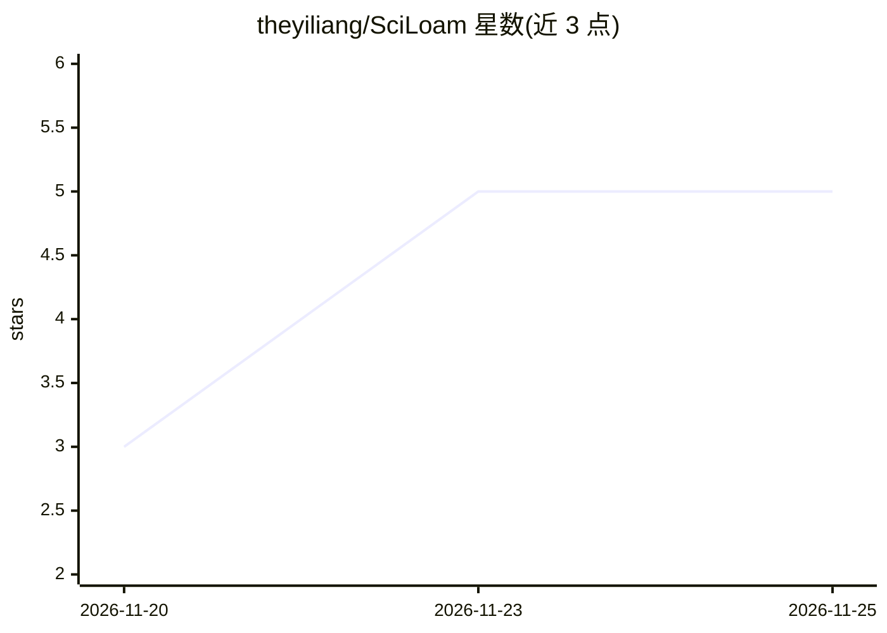

# theyiliang/SciLoam

⭐ 5 · Python · MIT · 推送 2026-11-22 · [GitHub](https://github.com/theyiliang/SciLoam) · 个人维护 · 中文 README

**给小型科研团队：带权限、版本与可溯源问答的知识协同工作台**

面向小型科研团队的私有化知识协同平台，把知识录入、版本沉淀、指定版本送审、成果发布与授权问答连成一条可追溯链路。权限与项目管理分离，按空间授予负责人/编辑/只读；每次修改保留不可变历史，审核只针对提交的版本快照。问答只在当前用户授权范围内检索（默认本地 BM25），回答关联具体版本与原文片段；未配置模型时仅返回本地证据摘录，外部模型与向量服务需显式开启。技术栈为 FastAPI + React/TypeScript + SQLite，支持本地开发与 Docker 部署。

## 筛选速览

| 维度 | 判定 | 备注 |
|---|---|---|
| AI 角色 | `ai-native` | 本体是模型或模型工具 |
| 许可风险 | `permissive` | MIT |
| 部署形态 | `self-host` | docker 或自建部署 |
| 模型依赖 | — | README 未给出锁定关系 |
| 硬件要求 | — | 无带数字的原话,不猜 |
| 安装摩擦 | `low` | 无编译、无系统依赖或容器化 |
| 成熟度 | — | 结构信号不足 |

## 能力要点

- 送审与审核绑定具体版本快照，后续编辑不覆盖已提交内容
- 问答只检索当前用户有权访问的资料，回答关联原文片段
- 默认本地 BM25 检索，外部模型与向量服务默认关闭、需显式开启
- SQLite 单文件存储，备份整个数据目录即可

## 适用场景

- 课题组管理项目依据、个人资料与协作知识并按版本送审
- 在私有部署环境下做基于知识库的问答并核验回答出处
- 科研协作中避免依赖聊天记录找回历史工作

## 场景标签

`RAG` `科研工具` `知识库管理` · 领域:知识与检索

## 证据(README 行号)

> L26: - **AI 回答可以核验**：只检索当前用户有权访问的资料，回答关联具体版本与原文片段；默认本地检索，外部模型与向量服务需显式开启。
> L34: |**基于知识库问答**|在授权范围内检索与回答；材料不足时明确说明缺口，不编造依据|
> L112: |`LLM_API_KEY`|空|为空时仅本地证据摘录，不调用外部模型|

## 星数曲线

2026-11-20 3 → 2026-11-25 5（+2）

---
*卡片 v1 · prompt 1.4 · 生成 2026-11-21 · 置信度 high · 依据 README sha `9eb191bb3aa0` · [字段定义](../../DATASET.md)*
