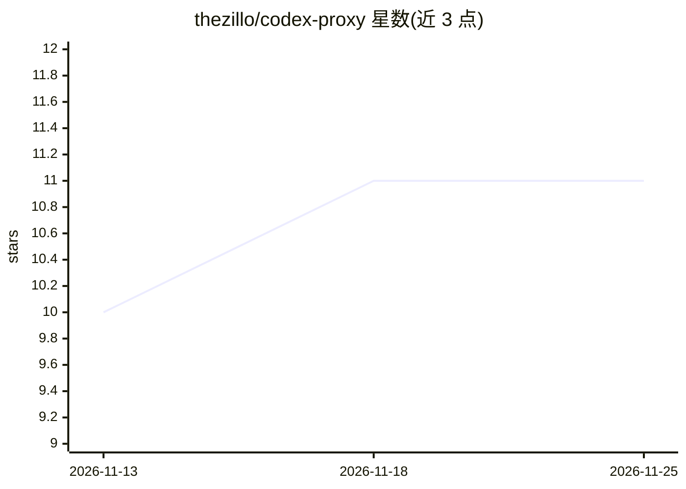

# thezillo/codex-proxy

⭐ 11 · Rust · 推送 2026-11-23 · [GitHub](https://github.com/thezillo/codex-proxy) · 个人维护

**面向订阅用户的 OpenAI 兼容代理：把 Codex 接入任意 OpenAI 客户端**

Rust 编写的单二进制反向代理，把 ChatGPT 订阅的 Codex Responses API 封装为 OpenAI 兼容端点 `/v1`，转发到 `chatgpt.com` 并使用 `codex login` 凭据自动刷新 token。提供 chat completions 翻译、Responses 原样透传、多账号池与付费 fallback、Prometheus 指标、按客户端命名的用量日志，以及启动安全守卫（公网绑定缺认证时拒绝启动）。无数据库，常驻内存约 3 MiB。适合已有 ChatGPT 订阅并想通过标准 OpenAI 客户端调用 Codex 的开发者。

## 筛选速览

| 维度 | 判定 | 备注 |
|---|---|---|
| AI 角色 | `ai-ecosystem` | LLM/agent 周边工具 |
| 许可风险 | `none` | — |
| 部署形态 | `self-host` | docker 或自建部署 |
| 模型依赖 | — | README 未给出锁定关系 |
| 硬件要求 | — | 无带数字的原话,不猜 |
| 安装摩擦 | `low` | 无编译、无系统依赖或容器化 |
| 成熟度 | — | 结构信号不足 |

## 能力要点

- OpenAI 兼容端点：chat completions 翻译与 Responses 字节级透传
- 使用 codex login 凭据并自动刷新 token，凭据存于 auth.json
- 多 ChatGPT 账号池 + 可配置付费 fallback 提供商
- Prometheus 指标与按客户端名称记录的 token 用量日志

## 适用场景

- 让任意 OpenAI SDK/客户端调用 ChatGPT 订阅的 Codex 模型
- 把 codex CLI 指向代理并保持会话连续性
- 为团队分发客户端 API key 并审计谁的 token 在消耗

## 场景标签

`模型网关` `编码 Agent` · 领域:Agent 开发

## 证据(README 行号)

> L3: OpenAI-compatible proxy for the Codex (ChatGPT subscription) Responses API.
> L11: - `http://<host>:8787/v1` — an OpenAI-compatible endpoint (chat completions +
> L5: credentials from `codex login`, refreshing the token as needed. Rust, single

## 星数曲线

2026-11-13 10 → 2026-11-25 11（+1）

---
*卡片 v1 · prompt 1.4 · 生成 2026-11-18 · 置信度 high · 依据 README sha `30d6f6eee4e1` · [字段定义](../../DATASET.md)*
