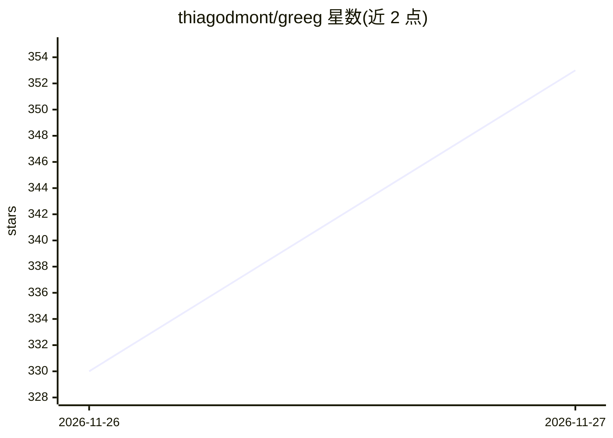

# thiagodmont/greeg

⭐ 353 · Rust · MIT · 推送 2026-11-25 · [GitHub](https://github.com/thiagodmont/greeg) · [官网](https://thiagodmont.dev/) · 个人维护

**为编码 agent 提供索引化代码搜索的 CLI 工具**

greeg 是一个 Rust 编写的命令行代码搜索工具，兼容 ripgrep 的常用 flags，从自建索引回答查询：定义排前、按排名输出并限制在 token 预算内（默认 2,000），页脚说明省略内容及恢复 flag。提供符号级命令（def/refs/callers）与自然语言查找。通过 hook 与 Claude Code 和 Codex 集成，将 agent 的 rg/grep 命令重写为 greeg；无法精确翻译的命令回退到原工具。任何能运行命令的 agent 都可直接调用。

## 筛选速览

| 维度 | 判定 | 备注 |
|---|---|---|
| AI 角色 | `ai-ecosystem` | LLM/agent 周边工具 |
| 许可风险 | `permissive` | MIT |
| 部署形态 | `library` | 以包/库形式分发 |
| 模型依赖 | — | README 未给出锁定关系 |
| 硬件要求 | — | 无带数字的原话,不猜 |
| 安装摩擦 | `low` | 无编译、无系统依赖或容器化 |
| 成熟度 | — | 结构信号不足 |

## 能力要点

- 兼容 ripgrep flags 的搜索，回答来自自动构建并保持新鲜的索引
- 定义优先排序，输出限制在可配置 token 预算内，页脚说明省略内容
- 符号命令：def/refs/callers/implementations 与自然语言查找
- hook 集成 Claude Code 与 Codex，自动重写 rg/grep 命令

## 适用场景

- 让 coding agent 的代码搜索结果适配上下文 token 预算
- 在代码库中定位符号定义、引用与调用方
- 用自然语言描述问题来定位相关文件

## 场景标签

`编码 Agent` · 领域:编码与开发

## 证据(README 行号)

> L3: **Code search built for coding agents.** Your agent searches with `rg` and
> L32: Works with Claude Code and Codex through a hook, and with any agent that can

## 星数曲线

2026-11-26 330 → 2026-11-27 353（+23）

---
*卡片 v1 · prompt 1.4 · 生成 2026-11-26 · 置信度 high · 依据 README sha `8a713eec4011` · [字段定义](../../DATASET.md)*
