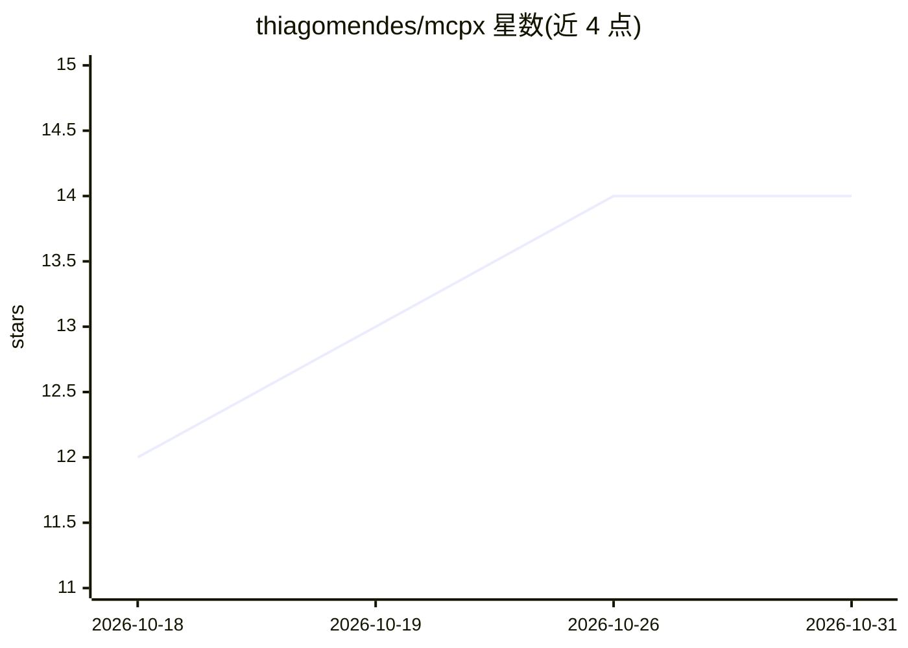

# thiagomendes/mcpx

⭐ 14 · Rust · Apache-2.0 · 推送 2026-01-09 · [GitHub](https://github.com/thiagomendes/mcpx) · [官网](https://www.tmdevlab.com/mcpx-gateway-incubating.html) · 个人维护

**企业自托管 MCP 网关：安全连接 AI agent 与 MCP 服务器**

用 Rust(Axum)与 Vue 3 实现的自托管 Model Context Protocol 网关，面向需要集中管控 AI agent 访问的组织。通过代理层路由 MCP 流量并注入凭证，提供按服务器的工具允许/封禁名单、虚拟网关聚合多服务器、审计日志与时序指标、OAuth/API Key/服务账户多种认证及多租户 RBAC。限制：仅支持 MCP Tools，Resources 与 Prompts 不支持。部署依赖 Docker Compose 或 Kubernetes，需 PostgreSQL 15 + TimescaleDB 扩展；README 声明为孵化期项目。

## 筛选速览

| 维度 | 判定 | 备注 |
|---|---|---|
| AI 角色 | `ai-ecosystem` | LLM/agent 周边工具 |
| 许可风险 | `permissive` | Apache-2.0 |
| 部署形态 | `self-host` | docker 或自建部署 |
| 模型依赖 | — | README 未给出锁定关系 |
| 硬件要求 | — | 无带数字的原话,不猜 |
| 安装摩擦 | `low` | 无编译、无系统依赖或容器化 |
| 成熟度 | `idea` | |

## 能力要点

- 按服务器配置工具允许/封禁名单与命名空间前缀隔离
- 虚拟网关将多个 MCP 服务器聚合为单一端点
- 全量请求/响应审计日志与时序指标查询
- OAuth(Google/GitHub/Microsoft)、PAT、服务账户等多认证方式与多租户 RBAC

## 适用场景

- 企业集中管理多个 MCP 服务器的凭证与访问控制
- 限制 AI agent 可调用的工具范围并审计全部调用
- 将多个 MCP 服务器聚合成一个端点供 Claude Desktop 等客户端连接

## 场景标签

`模型网关` · 领域:Agent 开发

## 证据(README 行号)

> L25: mcpx is a self-hosted gateway for the Model Context Protocol (MCP). It enables organizations to securely connect AI
> L34: |**Tool Governance**|Allowlist or blocklist specific tools per server|

## 星数曲线

2026-10-18 12 → 2026-10-31 14（+2）

---
*卡片 v1 · prompt 1.4 · 生成 2026-10-31 · 置信度 high · 依据 README sha `6b87cc6399f5` · [字段定义](../../DATASET.md)*
