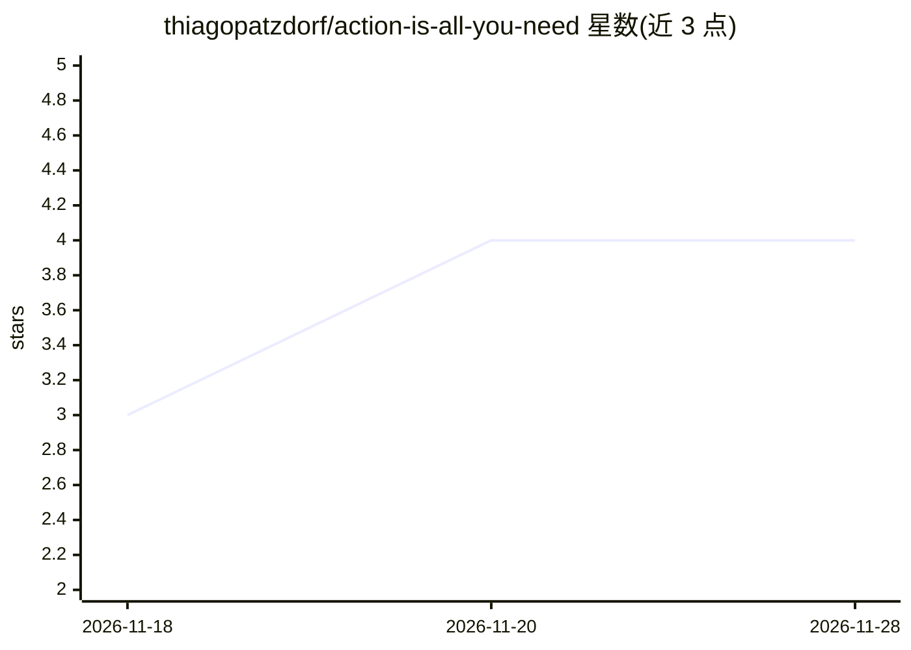

# thiagopatzdorf/action-is-all-you-need

⭐ 4 · Python · Apache-2.0 · 推送 2026-11-14 · [GitHub](https://github.com/thiagopatzdorf/action-is-all-you-need) · 个人维护 · 中文 README

**以 agent 轨迹从零训练小模型并评测动作正确性的研究工件**

一个包含工作论文、评测脚本与结果的实验仓库：在 agent 动作轨迹上从零训练四个小规模 transformer（126M–897M 参数），以是否发出正确的工具调用与参数作为评分标准，并给出随规模扩展的准确率结果与单次调用耗时对比。模型是轨迹上的下一词预测器，非对话模型，未经指令微调；评测仅覆盖首个动作、314 个测试样本，作者声明未做安全或生产评估。仓库提供语料下载与转换脚本、评分器、结果 JSON 及 Hugging Face 权重。

## 筛选速览

| 维度 | 判定 | 备注 |
|---|---|---|
| AI 角色 | `ai-knowledge` | 知识聚合/清单类 |
| 许可风险 | `permissive` | Apache-2.0 |
| 部署形态 | `None` |  |
| 模型依赖 | — | README 未给出锁定关系 |
| 硬件要求 | — | 无带数字的原话,不猜 |
| 安装摩擦 | `low` | 无编译、无系统依赖或容器化 |
| 成熟度 | `idea` | |

## 能力要点

- 四个从零训练的小模型，参数量 125.8M–896.5M，附扩展曲线数据
- 多步评分器（gold history）逐调用打分，结果 JSON 机器可读
- 语料为开源轨迹数据（Toucan-1.5M、SWE-smith 等），无专有数据
- 代码与权重 Apache-2.0，论文文本 CC BY 4.0

## 适用场景

- 复现 agent 动作生成的小模型训练与评分实验
- 研究模型规模与工具调用准确率的关系
- 下载权重用于轨迹上的下一词预测实验

## 场景标签

`模型训练` `模型评测` · 领域:评测与运维

## 证据(README 行号)

> L3: Small transformers trained from scratch on nothing but records of agents acting, and measured on one thing: do they
> L43: - Research artifacts. Not evaluated for safety or for production use.
> L49: |`PAPER.md`|The paper|

## 星数曲线

2026-11-18 3 → 2026-11-28 4（+1）

---
*卡片 v1 · prompt 1.4 · 生成 2026-11-21 · 置信度 high · 依据 README sha `394c9541a427` · [字段定义](../../DATASET.md)*
