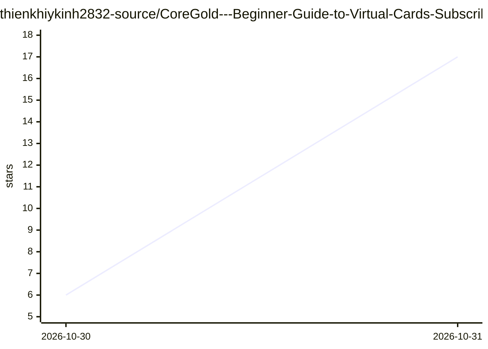

# thienkhiykinh2832-source/CoreGold---Beginner-Guide-to-Virtual-Cards-Subscribe-to-Global-Services-with-Ease

⭐ 17 · 推送 2026-10-29 · [GitHub](https://github.com/thienkhiykinh2832-source/CoreGold---Beginner-Guide-to-Virtual-Cards-Subscribe-to-Global-Services-with-Ease) · [官网](https://app.coregold.io/signup?invite_code=ADvlj9b) · 组织维护 · 中文 README

**CoreGold 虚拟信用卡服务的订阅付款教程（含 AI 工具付费）**

面向中国用户的推广式操作指南，介绍如何通过 CoreGold 平台用 USDT 充值、生成美区 Visa/Mastercard 虚拟信用卡，并绑定到 ChatGPT、Claude、Midjourney 等海外服务完成订阅付款。内容包括注册充值流程、开卡步骤、账单地址填写、消费限额设置与闲置卡注销提现说明，并列出按类别整理的常用平台适配参考。全文为图文教程，不提供任何代码或软件安装内容。

## 筛选速览

| 维度 | 判定 | 备注 |
|---|---|---|
| AI 角色 | `ai-knowledge` | 知识聚合/清单类 |
| 许可风险 | `none` | — |
| 部署形态 | `None` |  |
| 模型依赖 | — | README 未给出锁定关系 |
| 硬件要求 | — | 无带数字的原话,不猜 |
| 安装摩擦 | `low` | 无编译、无系统依赖或容器化 |
| 成熟度 | — | 结构信号不足 |

## 能力要点

- 四步流程：注册、USDT 充值、生成虚拟卡、平台绑定扣费
- 系统生成 16 位卡号、CVV 与配套英文账单地址
- 按 AI 生产力、办公、娱乐、建站分类的常用平台参考表
- 消费限额设置与闲置卡注销后余额退回说明

## 适用场景

- 没有海外银行卡时订阅 ChatGPT、Claude 等 AI 工具
- 用虚拟卡设置消费上限避免订阅服务自动续费
- 小额订阅海外流媒体后注销卡片止损

## 场景标签

 · 领域:支付服务/教程

## 证据(README 行号)

> L22: ## 🛠️ 新手实操四步法：从开卡到成功订阅
> L45: 1. 打开你需要订阅的海外平台（如 ChatGPT、Midjourney、Notion 等），进入升级会员或结账页面。

## 星数曲线

2026-10-30 6 → 2026-10-31 17（+11）

---
*卡片 v1 · prompt 1.4 · 生成 2026-10-30 · 置信度 mid · 依据 README sha `667fc3d9814d` · [字段定义](../../DATASET.md)*
