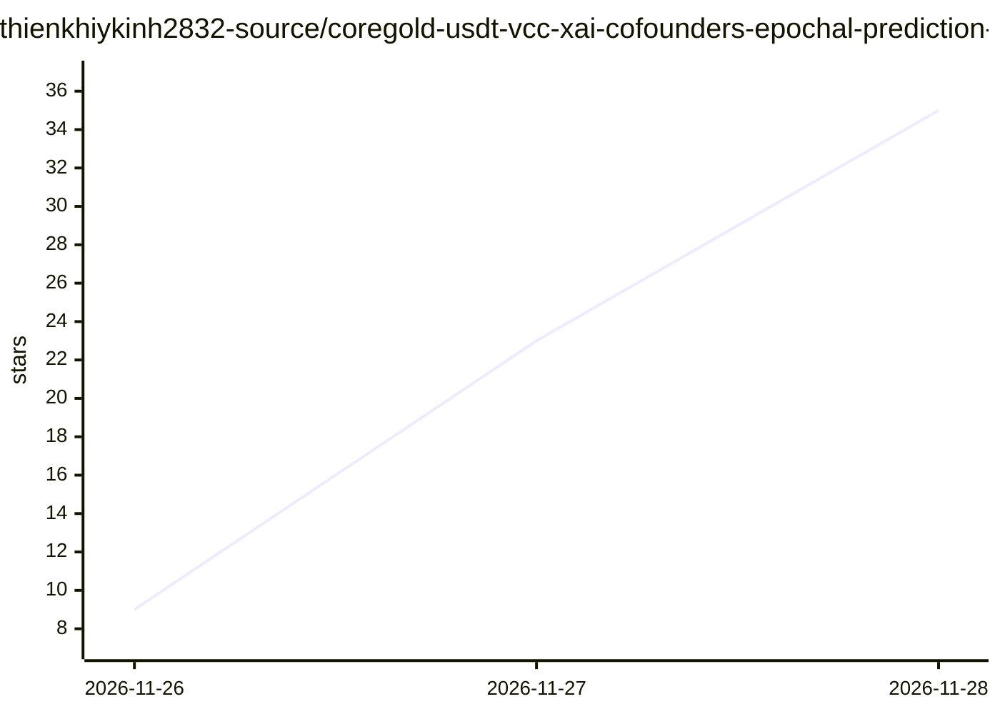

# thienkhiykinh2832-source/coregold-usdt-vcc-xai-cofounders-epochal-prediction-agents-guide

⭐ 35 · 推送 2026-11-25 · [GitHub](https://github.com/thienkhiykinh2832-source/coregold-usdt-vcc-xai-cofounders-epochal-prediction-agents-guide) · [官网](https://app.coregold.io/signup?invite_code=ADvlj9b) · 个人维护 · 中文 README

**借 AI 资讯推广 CoreGold 虚拟卡开卡绑定的中文教程**

该 README 为一篇中文推广型教程文章：以 xAI 联合创始人新公司 Epochal 的融资消息为引子，主体内容是介绍 CoreGold 虚拟卡（USDT/TRC20 充值）的注册、开卡、账单地址配置及绑定 Apple Pay/Google Pay 流程，面向需要多账号支付隔离的开发者。文中含邀请码注册链接，无任何代码、安装或运行说明，不构成可运行的开源软件。

## 筛选速览

| 维度 | 判定 | 备注 |
|---|---|---|
| AI 角色 | `ai-knowledge` | 知识聚合/清单类 |
| 许可风险 | `none` | — |
| 部署形态 | `None` |  |
| 模型依赖 | — | README 未给出锁定关系 |
| 硬件要求 | — | 无带数字的原话,不猜 |
| 安装摩擦 | `low` | 无编译、无系统依赖或容器化 |
| 成熟度 | — | 结构信号不足 |

## 能力要点

- 描述 CoreGold 虚拟卡的注册与 USDT(TRC20) 充值流程
- 说明开卡、账单信息配置与绑定 Apple Pay/Google Pay 步骤
- 正文以 Epochal 融资资讯与多账号支付隔离话题引入

## 适用场景

- 了解文中介绍的开卡与数字钱包绑定步骤
- 了解文中提到的多账号支付隔离做法

## 场景标签

 · 领域:支付工具/推广内容

## 证据(README 行号)

> L2: 11 月 24 日，xAI 三位联合创始人带着 1 亿美元融资官宣新公司 Epochal，主攻超人类预测智能体与历史网页回溯——聊聊开发者在跑多账号爬虫、数据接口和海外工具对比时，怎么用 CoreGold 虚拟卡 避免支付层关联。
> L25: 访问 **CoreGold 官方平台**：https://app.coregold.io/signup?invite_code=ADvlj9b，使用常用邮箱注册并登录进入用户后台。
> L46: ### 🚀 立即注册 CoreGold，搭建你的独立隔离测试卡库

## 星数曲线

2026-11-26 9 → 2026-11-28 35（+26）

---
*卡片 v1 · prompt 1.4 · 生成 2026-11-26 · 置信度 high · 依据 README sha `c88f7d89be7d` · [字段定义](../../DATASET.md)*
