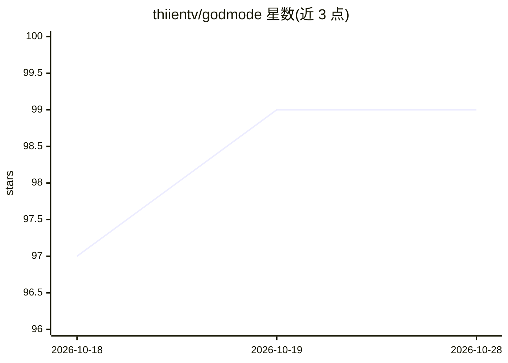

# thiientv/godmode

⭐ 99 · Python · MIT · 推送 2026-08-26 · [GitHub](https://github.com/thiientv/godmode) · [官网](https://thiientv.github.io/godmode) · 个人维护 · 中文 README

**给 AI 编码 agent 的工程化技能库：规划、TDD、评审、验证**

以可组合 Agent Skills 形式分发的工程能力仓库，供 Claude Code、Codex 等 Agent Skills 兼容客户端使用：覆盖代码库理解、方案设计、实现规划、TDD、根因调试、代码评审、完成验证、并行任务、发布集成等 30 余个技能，以及前端、API、数据库、安全等领域能力。无需专有运行时，把技能复制到项目 skills 目录或以插件方式安装；仓库自带验证器、路由夹具与行为评测等确定性校验工具。当前为 Pre-1.0 公开预览，客户端兼容性以记录证据为准。

## 筛选速览

| 维度 | 判定 | 备注 |
|---|---|---|
| AI 角色 | `ai-ecosystem` | LLM/agent 周边工具 |
| 许可风险 | `permissive` | MIT |
| 部署形态 | `None` |  |
| 模型依赖 | — | README 未给出锁定关系 |
| 硬件要求 | — | 无带数字的原话,不猜 |
| 安装摩擦 | `low` | 无编译、无系统依赖或容器化 |
| 成熟度 | `idea` | |

## 能力要点

- 30+ 可组合 Agent Skills，覆盖规划/TDD/评审/验证等工程工作流
- 自带验证器、行为评测与仓库质量门禁，技能目录本身可测试
- 分发为可移植技能仓库，无专有运行时依赖
- 客户端兼容性以 docs/compatibility.md 的记录证据为准

## 适用场景

- 让 AI 编码 agent 在改代码前先理解代码库并做设计规划
- 为高风险变更组合 TDD、独立评审与证据驱动的完成验证
- 通过技能让 agent 具备安全、性能、可观测性等领域专长

## 场景标签

`编码 Agent` `提示工程` `代码审查` `模型评测` · 领域:Agent 开发

## 证据(README 行号)

> L27: Godmode packages those behaviors as **composable Agent Skills** rather than one large system prompt or a proprietar
> L56: The repository includes validators, routing fixtures, behavior evaluations, evidence tracking, lifecycle checks, an
> L60: Godmode is distributed as a repository of portable skills. No proprietary runtime is required.

## 星数曲线

2026-10-18 97 → 2026-10-28 99（+2）

---
*卡片 v1 · prompt 1.4 · 生成 2026-10-23 · 置信度 high · 依据 README sha `68727cccadf2` · [字段定义](../../DATASET.md)*
