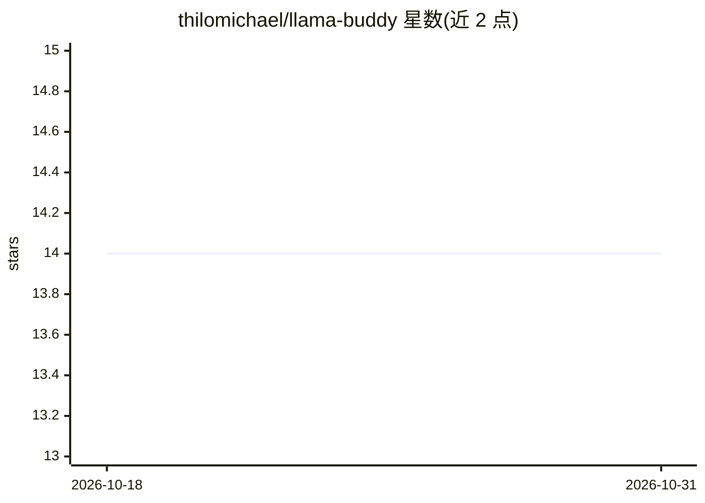

# thilomichael/llama-buddy

⭐ 14 · Python · MIT · 推送 2026-10-16 · [GitHub](https://github.com/thilomichael/llama-buddy) · 个人维护

**llama.cpp 的 CLI 封装：一条命令管理、下载并本地运行 LLM**

围绕 llama-server 构建的命令行工具 llb，以后台守护进程方式启停服务、通过 llama.cpp 自带 preset 文件实现多模型路由（不引入自有配置格式）、交互式搜索 HuggingFace 并下载 GGUF 模型、查看 GGUF 元数据与采样参数，支持空闲释放显存、VRAM 用量跟踪与 MTP 投机解码自动接入。需 Python 3.10+ 且 llama-server 已在 PATH 上。面向在本地运行 GGUF 模型的开发者。

## 筛选速览

| 维度 | 判定 | 备注 |
|---|---|---|
| AI 角色 | `ai-ecosystem` | LLM/agent 周边工具 |
| 许可风险 | `permissive` | MIT |
| 部署形态 | `library` | 以包/库形式分发 |
| 模型依赖 | local-ok | 支持本地模型 |
| 硬件要求 | — | 无带数字的原话,不猜 |
| 安装摩擦 | `low` | 无编译、无系统依赖或容器化 |
| 成熟度 | — | 结构信号不足 |

## 能力要点

- 后台启停 llama-server 守护进程，多模型路由复用 llama.cpp preset 文件
- 交互式搜索 HuggingFace、选量化并下载 GGUF（支持进度与断点续传）
- GGUF 检查器与采样参数同步（GGUF 推荐参数写入 preset）
- 空闲超时释放模型权重、解析日志显示每模型 VRAM 用量

## 适用场景

- 用一条命令在本地下载并启动 GGUF 模型服务
- 查看模型元数据、架构与当前生效的采样参数
- 为不同模型配置上下文长度、GPU 层数等覆盖项

## 场景标签

`模型网关` · 领域:Agent 开发

## 证据(README 行号)

> L3: **A friendly CLI wrapper for llama.cpp**
> L6: Think of it as an ollama-like experience built on top of `llama-server`.
> L14: - **Background server** &mdash; start/stop/restart `llama-server` as a daemon

## 星数曲线

2026-10-18 14 → 2026-10-31 14（+0）

---
*卡片 v1 · prompt 1.4 · 生成 2026-10-31 · 置信度 high · 依据 README sha `38108cb0c501` · [字段定义](../../DATASET.md)*
