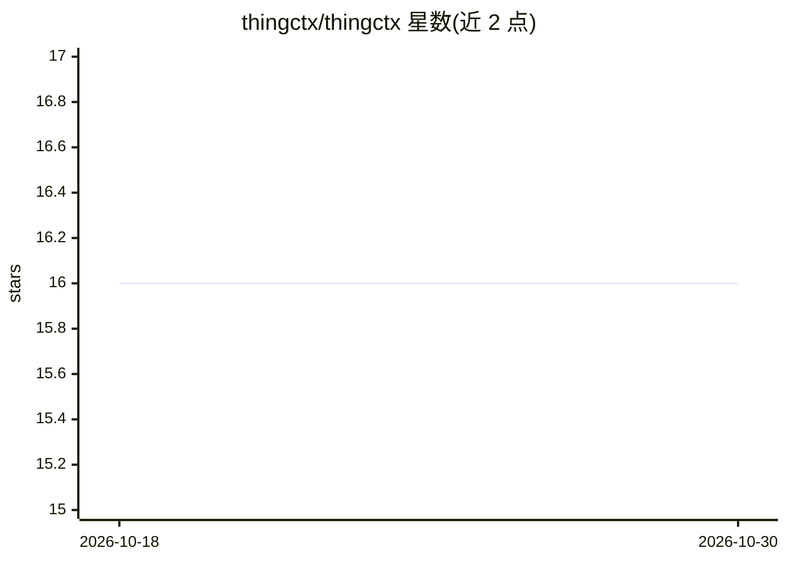

# thingctx/thingctx

⭐ 16 · Python · Apache-2.0 · 推送 2026-10-26 · [GitHub](https://github.com/thingctx/thingctx) · [官网](https://thingctx.com) · 个人维护

**把 API/设备描述转为 AI agent 工具的 Python 库，按操作授权**

thingctx 读取 W3C WoT Thing Description（JSON 文件，可从 OpenAPI 3.x 编译），将其中的 actions/properties/events 投影为 AI agent 可调用的工具，由被描述的系统自身充当服务器，无需为每个集成部署服务。调用前有两层控制：人工审批门（declared/destructive/all/never 四档）与基于策略的逐操作授权（PDP + 身份声明）；密钥由 binding 持有，模型不可见。提供 Python 库、命令行、通用 MCP bridge 三种使用方式，支持 local/exec/HTTP/MQTT/Redis 等传输，exec 传输默认锁定。面向需要让 agent 安全接入外部系统与设备的开发者。

## 筛选速览

| 维度 | 判定 | 备注 |
|---|---|---|
| AI 角色 | `ai-ecosystem` | LLM/agent 周边工具 |
| 许可风险 | `permissive` | Apache-2.0 |
| 部署形态 | `library` | 以包/库形式分发 |
| 模型依赖 | — | README 未给出锁定关系 |
| 硬件要求 | — | 无带数字的原话,不猜 |
| 安装摩擦 | `low` | 无编译、无系统依赖或容器化 |
| 成熟度 | — | 结构信号不足 |

## 能力要点

- Thing Description 投影为工具，可从 OpenAPI 3.x spec 编译生成
- 按 (thing, affordance, operation) 粒度授权，read 与 write 可分别放行/拒绝
- 审批门四档策略，覆盖 LLM 循环、CLI 与 MCP bridge
- 观察/执行/拒绝记录采用 SOSA/PROV-O 等公开词汇表，密钥不进模型

## 适用场景

- 让 AI agent 通过一份描述文件调用 REST API、MQTT 设备或本地进程
- 为 MCP 客户端（如 Claude Desktop）提供一个通用工具服务桥
- 对 agent 的设备写操作强制人工审批并留审计记录

## 场景标签

`Agent 框架` · 领域:Agent 开发

## 证据(README 行号)

> L11: **thingctx turns a description of any API, device, or local process into
> L12: tools an AI agent can call: authorized per operation, over the system's own
> L13: transport, and the agent never holds your keys.** The description is a

## 星数曲线

2026-10-18 16 → 2026-10-30 16（+0）

---
*卡片 v1 · prompt 1.4 · 生成 2026-10-30 · 置信度 high · 依据 README sha `c2cc453e13e1` · [字段定义](../../DATASET.md)*
