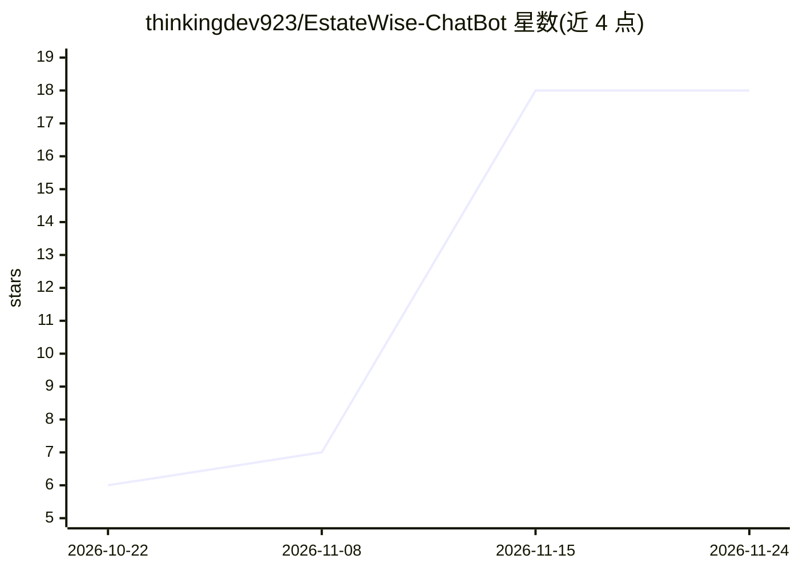

# thinkingdev923/EstateWise-ChatBot

⭐ 18 · TypeScript · MIT · 推送 2026-10-05 · [GitHub](https://github.com/thinkingdev923/EstateWise-ChatBot) · [官网](https://estatewise.vercel.app) · 个人维护

**面向 Chapel Hill 地区购房者的 AI 房产问答与推荐应用**

面向北卡 Chapel Hill 及周边地区的全栈房产应用：通过聊天界面提供个性化房源推荐，结合混合 RAG（Pinecone 向量检索 + Neo4j 图增强）、Mixture-of-Experts 路由、CoT 推理与 k-Means 聚类。功能覆盖 JWT/WebAuthn 认证、对话历史管理与分支、AI 生成的 Chart.js 图表、交易分析器、社区论坛、地图页与实时流式响应。提供 Vercel 在线版本，README 含完整技术栈清单与 RAG 架构说明。

## 筛选速览

| 维度 | 判定 | 备注 |
|---|---|---|
| AI 角色 | `ai-native` | 本体是模型或模型工具 |
| 许可风险 | `permissive` | MIT |
| 部署形态 | `self-host` | docker 或自建部署 |
| 模型依赖 | — | README 未给出锁定关系 |
| 硬件要求 | — | 无带数字的原话,不猜 |
| 安装摩擦 | `low` | 无编译、无系统依赖或容器化 |
| 成熟度 | — | 结构信号不足 |

## 能力要点

- Hybrid RAG：Pinecone kNN 向量检索 + Neo4j 图增强融合生成
- MoE 路由：主模型在 5 个专家子模型间分发查询，含手动专家视图
- 用户点赞/点踩反馈按会话调整专家权重
- 定期爬取 Zillow 房源元数据并通过 MCP 工具暴露

## 适用场景

- 找房时通过对话获得个性化房源推荐
- 查看某个社区的房源统计与趋势图表
- 分析一处房产是否值得入手（交易评分）

## 场景标签

`聊天机器人` `RAG` · 领域:对话与助手

## 证据(README 行号)

> L3: **EstateWise** is a **full‑stack, monorepo AI/ML** **chatbot & data analytics project** built for real estates in _C
> L107: - **Hybrid RAG (Vector + Graph):** Uses Pinecone for kNN‑based vector retrieval and Neo4j for graph enrichment bef
> L117: - **Mixture of Experts (MoE):** Dynamically routes each query through a master model to select specialized sub‑mod

## 星数曲线

2026-10-22 6 → 2026-11-24 18（+12）

---
*卡片 v1 · prompt 1.4 · 生成 2026-11-18 · 置信度 low · 依据 README sha `a1622b1eb664` · [字段定义](../../DATASET.md)*
