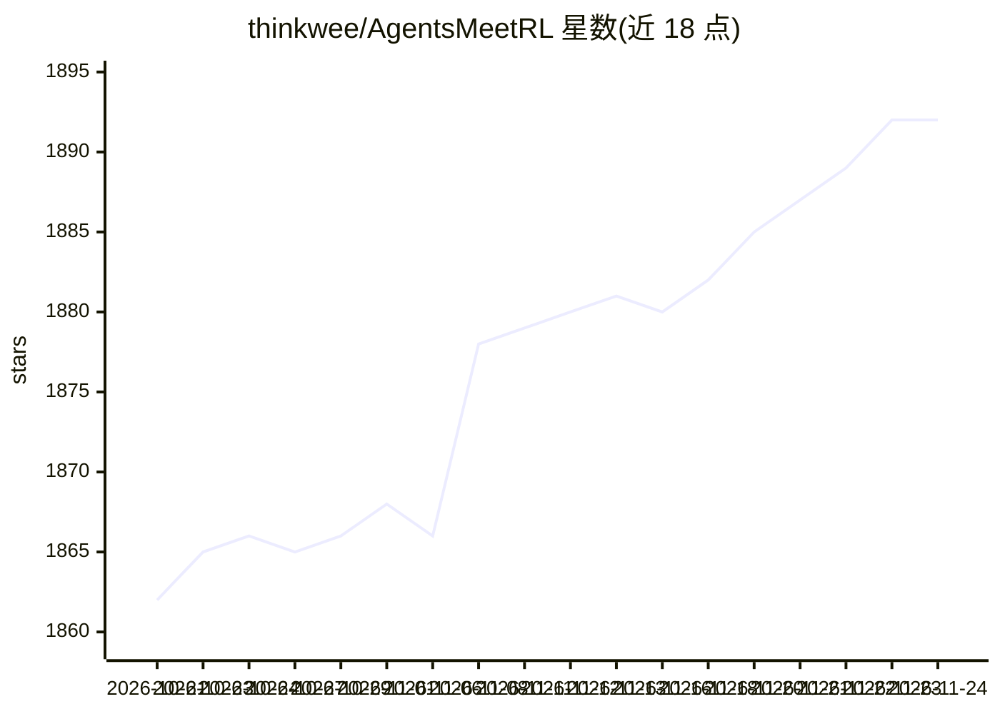

# thinkwee/AgentsMeetRL

⭐ 1,892 · HTML · 推送 2026-11-21 · [GitHub](https://github.com/thinkwee/AgentsMeetRL) · [官网](https://thinkwee.top/amr/) · 个人维护

**用强化学习训练 LLM Agent 的开源仓库清单**

一个 awesome 类清单，汇总使用强化学习训练 LLM Agent 的开源仓库。收录标准是项目须具备多轮交互或工具使用；条目按 16 个类别组织（基础框架、搜索与 RAG、Web/GUI、工具使用、代码与 SWE、安全等），并标注各项目依赖的 RL 框架、算法、奖励与环境等技术选择。清单同时打包为 Claude Code Skill（含 467 个项目的机器可读语料），支持按症状查询训练问题的答案并锚定到具体论文与仓库。收录项目需经人工核验含有真实 RL 训练或可执行环境代码。

## 筛选速览

| 维度 | 判定 | 备注 |
|---|---|---|
| AI 角色 | `ai-knowledge` | 知识聚合/清单类 |
| 许可风险 | `none` | — |
| 部署形态 | `None` |  |
| 模型依赖 | — | README 未给出锁定关系 |
| 硬件要求 | — | 无带数字的原话,不猜 |
| 安装摩擦 | `medium` | 含编译或系统依赖之一 |
| 成熟度 | — | 结构信号不足 |

## 能力要点

- 按 16 个分类组织的 LLM Agent 强化学习训练仓库清单
- 标注各项目依赖的 RL 框架、算法、奖励与环境（技术细节表）
- 打包为 Claude Code Skill，含 467 个项目的机器可读语料与工程手册
- 收录需核验仓库含真实 RL 训练或可执行环境代码，代码未公开的论文列入 Under Review

## 适用场景

- 为多轮工具使用 Agent 选择 RL 训练框架与算法
- 调研某类 Agent（如搜索、GUI、具身）的 RL 训练方案与技术选型
- 通过 Claude Code Skill 排查 GRPO/PPO 训练中奖励不涨、KL 爆炸等问题

## 场景标签

`精选清单` `强化学习` · 领域:学习与行业

## 证据(README 行号)

> L27: **AgentsMeetRL** is an awesome list that summarizes **open-source repositories** for training LLM Agents using rein
> L35: Taxonomy:
> L74: This list is also packaged as a **Claude Code Skill** — `agents-meet-rl` — that turns the corpus into an on-demand 

## 星数曲线

2026-10-21 1,862 → 2026-11-24 1,892（+30）

---
*卡片 v1 · prompt 1.4 · 生成 2026-11-23 · 置信度 high · 依据 README sha `ea6a30d9deba` · [字段定义](../../DATASET.md)*
