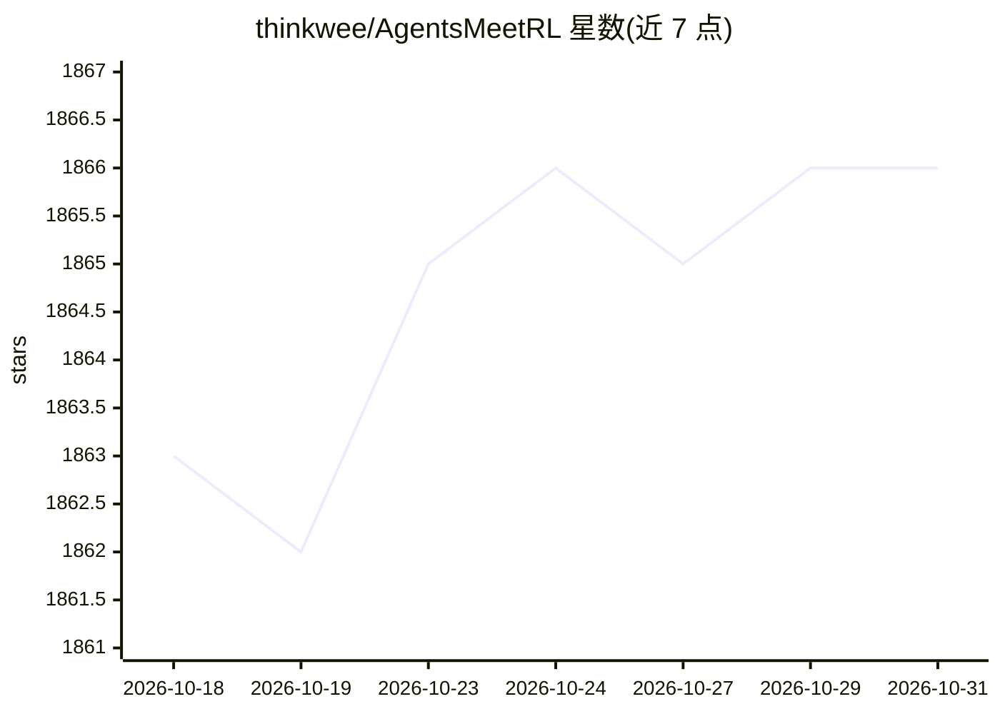

# thinkwee/AgentsMeetRL

⭐ 1,866 · HTML · 推送 2026-10-21 · [GitHub](https://github.com/thinkwee/AgentsMeetRL) · [官网](https://thinkwee.top/amr/) · 个人维护

**Agentic RL 开源仓库策展清单：LLM Agent 强化学习训练项目汇总**

汇总用强化学习训练 LLM Agent 的开源仓库的 awesome list，按 16 个类别组织（基础框架、Search & RAG、Web & GUI、Tool-Use、Multi-Agent RL、Safety、VLM Agent 等）。收录标准要求项目含多轮交互或工具使用，并逐仓库核验含真实 RL 训练代码；每个条目附技术细节表，枚举 RL 算法、奖励类型、单/多轮、工具使用等维度。另将语料打包为 Claude Code Skill（agents-meet-rl，411 项目快照），可按需安装用于训练调试问答。README 自述基于 LLM coding agent 的代码分析生成，可能含疏漏。

## 筛选速览

| 维度 | 判定 | 备注 |
|---|---|---|
| AI 角色 | `ai-knowledge` | 知识聚合/清单类 |
| 许可风险 | `none` | — |
| 部署形态 | `None` |  |
| 模型依赖 | — | README 未给出锁定关系 |
| 硬件要求 | — | 无带数字的原话,不猜 |
| 安装摩擦 | `medium` | 含编译或系统依赖之一 |
| 成熟度 | — | 结构信号不足 |

## 能力要点

- 16 类 taxonomy 覆盖 200+ 个 agentic RL 开源仓库
- 逐仓库核验含真实 RL 训练代码，未开源论文列入 Under Review
- 每条目附技术细节表（RL 算法/奖励类型/单多轮/工具使用）
- 另打包为 Claude Code Skill（411 项目机器可读语料）

## 适用场景

- 为多轮/工具使用型 agent 选型 RL 训练框架与算法
- 调研 agentic RL 各子方向的开源项目分布
- 排查 GRPO/PPO 训练问题时检索相关论文与仓库

## 场景标签

`精选清单` `强化学习` `科研工具` · 领域:学习与行业

## 证据(README 行号)

> L27: **AgentsMeetRL** is an awesome list that summarizes **open-source repositories** for training LLM Agents using rein
> L35: Taxonomy:

## 星数曲线

2026-10-18 1,863 → 2026-10-31 1,866（+3）

---
*卡片 v1 · prompt 1.4 · 生成 2026-10-21 · 置信度 high · 依据 README sha `1f36dc248c65` · [字段定义](../../DATASET.md)*
