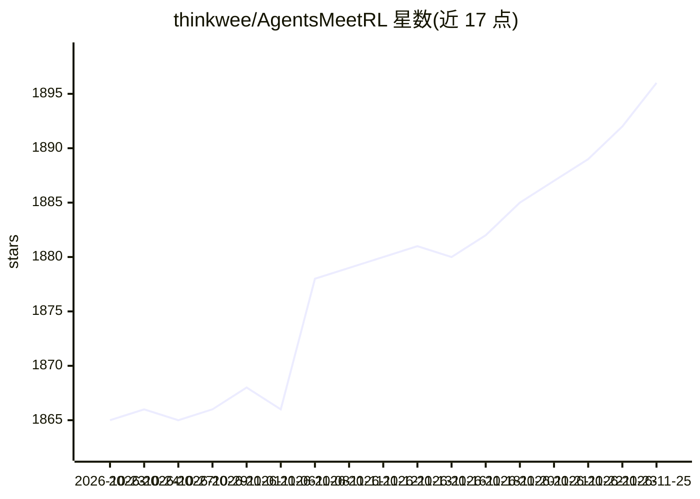

# thinkwee/AgentsMeetRL

⭐ 1,896 · HTML · 推送 2026-11-23 · [GitHub](https://github.com/thinkwee/AgentsMeetRL) · [官网](https://thinkwee.top/amr/) · 个人维护

**面向研究者汇总用 RL 训练 LLM Agent 的开源仓库清单**

以 awesome list 形式整理训练 LLM Agent 的强化学习开源仓库，按 16 个类别（基础框架、工具使用、Code & SWE、多智能体、环境等）组织，收录条目标注框架、算法、奖励与环境等技术选型。收录标准为多轮交互或工具使用，且经人工核查包含真实 RL 训练代码。另打包为 Claude Code Skill，基于 467 个项目的机器可读语料，提供训练调参、框架选型等问答与工程手册。内容主要由 LLM coding agent 代码分析生成并经人工复核，作者提示可能存在失实条目。

## 筛选速览

| 维度 | 判定 | 备注 |
|---|---|---|
| AI 角色 | `ai-knowledge` | 知识聚合/清单类 |
| 许可风险 | `none` | — |
| 部署形态 | `None` |  |
| 模型依赖 | — | README 未给出锁定关系 |
| 硬件要求 | — | 无带数字的原话,不猜 |
| 安装摩擦 | `medium` | 含编译或系统依赖之一 |
| 成熟度 | — | 结构信号不足 |

## 能力要点

- 按 16 类 taxonomy 组织的 agentic RL 仓库清单（总量从约 134 增至 205）
- 标注各仓库依赖的 RL 框架、算法、奖励与环境的表内技术细节
- 打包为 Claude Code Skill，附 467 项目机器可读语料与工程手册
- 每条目经打开仓库核查真实 RL 训练代码，arXiv ID 经 API 核验

## 适用场景

- 查找用 RL 训练 LLM Agent 的开源项目与技术选型参考
- 调研 agent RL 的奖励类型、环境与基准
- 在 Claude Code 中询问 GRPO/PPO 调参、框架选型等问题获得清单内出处

## 场景标签

`精选清单` · 领域:学习与行业

## 证据(README 行号)

> L27: **AgentsMeetRL** is an awesome list that summarizes **open-source repositories** for training LLM Agents using rein
> L36:  - **Base Framework**: General-purpose RL training frameworks for LLM agents (e.g., veRL, OpenRLHF, trl)
> L74: This list is also packaged as a **Claude Code Skill** — `agents-meet-rl` — that turns the corpus into an on-demand 

## 星数曲线

2026-10-23 1,865 → 2026-11-25 1,896（+31）

---
*卡片 v1 · prompt 1.4 · 生成 2026-11-24 · 置信度 high · 依据 README sha `2109164cfa2b` · [字段定义](../../DATASET.md)*
