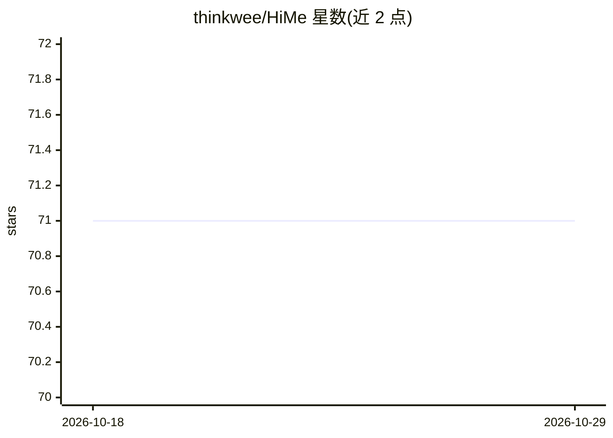

# thinkwee/HiMe

⭐ 71 · Python · NOASSERTION · 推送 2026-10-25 · [GitHub](https://github.com/thinkwee/HiMe) · [官网](https://thinkwee.top/hime/) · 组织维护 · 中文 README

**自托管本地个人健康 AI Agent 平台，接入可穿戴设备数据**

HiMe 是一个自托管、完全本地运行的开源个人健康 AI Agent 平台：通过 iOS/watchOS 伴生应用从 Apple Watch 与 iPhone 持续采集心率、HRV、血氧、睡眠等 50 余项指标，Agent 依据日程巡检与事件触发自动生成带图表的报告与主动提醒。服务端经 setup.sh 向导以 Docker 或原生模式部署，提供 Web 面板、Agent 监视器、技能系统，并可选 Telegram/飞书/微信（ClawBot 插件）IM 通道。项目声明为研究级软件，非医疗设备，许可证为 PolyForm Noncommercial（禁商用）。

## 筛选速览

| 维度 | 判定 | 备注 |
|---|---|---|
| AI 角色 | `ai-native` | 本体是模型或模型工具 |
| 许可风险 | `none` | NOASSERTION |
| 部署形态 | `None` |  |
| 模型依赖 | — | README 未给出锁定关系 |
| 硬件要求 | — | 无带数字的原话,不猜 |
| 安装摩擦 | `low` | 无编译、无系统依赖或容器化 |
| 成熟度 | `idea` | |

## 能力要点

- 从 Apple Watch/iPhone 实时摄取 50+ 项健康指标
- Agent 按计划巡检与事件触发自动分析并推送报告
- iOS 原生对话界面（流式回复、可折叠步骤、后台 APNs 推送）
- 可选 Telegram/飞书/微信 IM 网关，自托管数据不出本地

## 适用场景

- 我在手机上跟 AI 讨论自己的睡眠和心率数据并收到每周报告
- 把我 Apple Watch 的健康数据接到自己服务器上做自动分析
- 通过 Telegram/飞书/微信直接与我的健康 Agent 对话

## 场景标签

`AI 助手` `聊天机器人` · 领域:对话与助手

## 证据(README 行号)

> L20: HiMe (Health Intelligence Management Engine) is a self-hosted, fully local, secure, and open-source one-stop person
> L33: - Real-time wearable data ingestion from Apple Watch + iPhone, including heart rate, HRV, SpO2, sleep stages, worko
> L41: - Autonomous AI analysis with scheduled checks and event triggers, delivered as chart-rich reports.

## 星数曲线

2026-10-18 71 → 2026-10-29 71（+0）

---
*卡片 v1 · prompt 1.4 · 生成 2026-10-24 · 置信度 high · 依据 README sha `db1640088a0e` · [字段定义](../../DATASET.md)*
