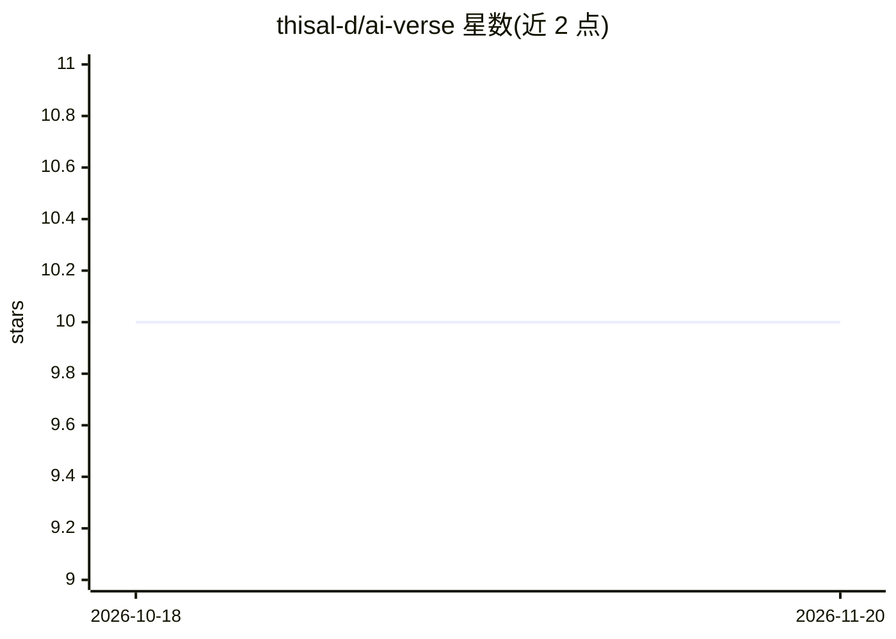

# thisal-d/ai-verse

⭐ 10 · JavaScript · 推送 2026-09-29 · [GitHub](https://github.com/thisal-d/ai-verse) · [官网](https://ai-verse.pages.dev/) · 个人维护

**面向开发者/学生等的 AI 工具目录站点（147 个工具，15 类）**

AI Verse 是一个 AI 工具发现平台，收录 147 个精选工具，按文本写作、编程、图像生成、视频、音频、教育、自动化、AI Agent 等 15 个类别组织，提供关键词/类别/定价（Free/Freemium/Paid/Open Source）筛选与收藏功能（本地存储，无需登录）。数据以 JSON 配置维护，社区通过专门分支增删改条目；前端为 React 19 + Vite，部署于 GitHub Pages。

## 筛选速览

| 维度 | 判定 | 备注 |
|---|---|---|
| AI 角色 | `ai-knowledge` | 知识聚合/清单类 |
| 许可风险 | `none` | — |
| 部署形态 | `None` |  |
| 模型依赖 | — | README 未给出锁定关系 |
| 硬件要求 | — | 无带数字的原话,不猜 |
| 安装摩擦 | `low` | 无编译、无系统依赖或容器化 |
| 成熟度 | — | 结构信号不足 |

## 能力要点

- 147 个精选工具，15 个类别组织
- 按关键词、类别、定价层筛选与本地收藏
- 通过 JSON 配置即可新增工具条目
- 社区驱动维护，专用 feature 分支管理增删改

## 适用场景

- 按任务（写作/编码/图像）查找合适的 AI 工具
- 按免费/开源等定价层筛选工具
- 向社区提交新 AI 工具收录

## 场景标签

`精选清单` · 领域:学习与行业

## 证据(README 行号)

> L12: **AI Verse** is a curated discovery platform for navigating the world of AI tools. Whether you're a developer, desi
> L14: With **147 hand-picked tools** across 15 categories, smart search, favorites, and pricing filters — it's your one-s
> L21: - 🎨 **15 Categories** — Text & Writing, Coding & Dev, Image Generation, Video & Animation, Audio & Voice, Research 

## 星数曲线

2026-10-18 10 → 2026-11-20 10（+0）

---
*卡片 v1 · prompt 1.4 · 生成 2026-11-19 · 置信度 high · 依据 README sha `6c27392ab091` · [字段定义](../../DATASET.md)*
