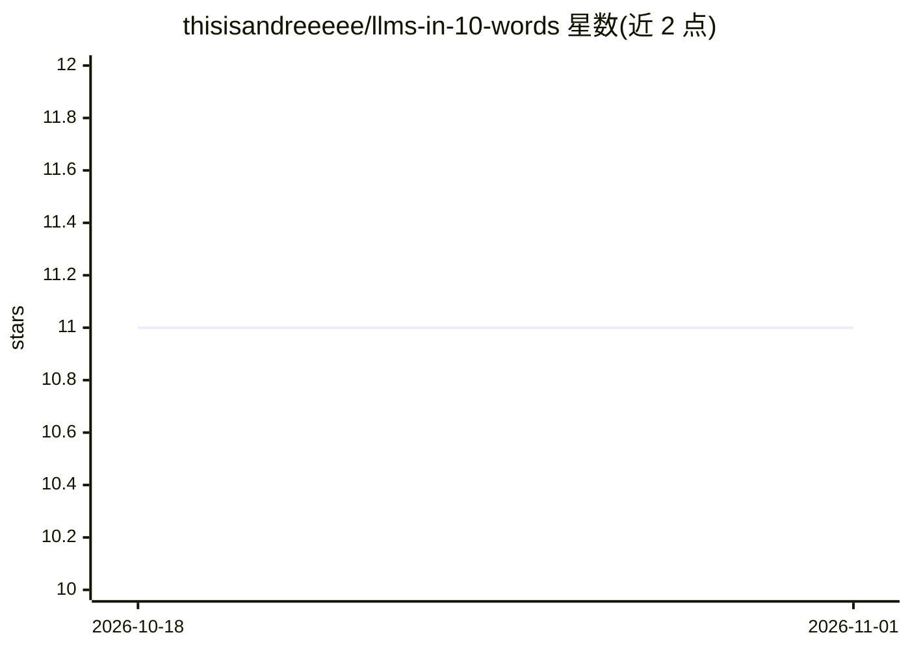

# thisisandreeeee/llms-in-10-words

⭐ 11 · MIT · 推送 2026-09-16 · [GitHub](https://github.com/thisisandreeeee/llms-in-10-words) · 个人维护

**用 10 词以内解释 LLM 核心概念的术语表**

纯内容型知识清单仓库：将 Transformer 架构（MHA/GQA/MLA/RoPE 等）、训练方法（SFT/DPO/RLHF/LoRA 等）、推理技术（KV 缓存/PagedAttention/量化/投机解码等）三类 LLM 概念逐条压缩为不超过 10 个英文词的一句话解释，每条附加粗术语名。无代码、无安装运行流程，通过贡献章节接受补充。适合作为学习速查卡片或面试/复习材料阅读。

## 筛选速览

| 维度 | 判定 | 备注 |
|---|---|---|
| AI 角色 | `ai-knowledge` | 知识聚合/清单类 |
| 许可风险 | `permissive` | MIT |
| 部署形态 | `None` |  |
| 模型依赖 | — | README 未给出锁定关系 |
| 硬件要求 | — | 无带数字的原话,不猜 |
| 安装摩擦 | `low` | 无编译、无系统依赖或容器化 |
| 成熟度 | — | 结构信号不足 |

## 能力要点

- 三类主题组织：Transformers 架构、训练、推理
- 每条概念压缩为 10 词以内的一句话定义
- 覆盖较新的架构变体（MLA/KDA/CSA2/CED/Latent MoE）

## 适用场景

- 快速查阅 LLM 术语的极简定义
- 学习或复习 Transformer 训练与推理概念
- 准备技术面试时的概念速记材料

## 场景标签

`教程课程` · 领域:学习与行业

## 证据(README 行号)

> L1: # LLMs in 10 words
> L3: Complex LLM concepts explained in **10 words or less**.

## 星数曲线

2026-10-18 11 → 2026-11-01 11（+0）

---
*卡片 v1 · prompt 1.4 · 生成 2026-11-01 · 置信度 high · 依据 README sha `e4c7083571d1` · [字段定义](../../DATASET.md)*
