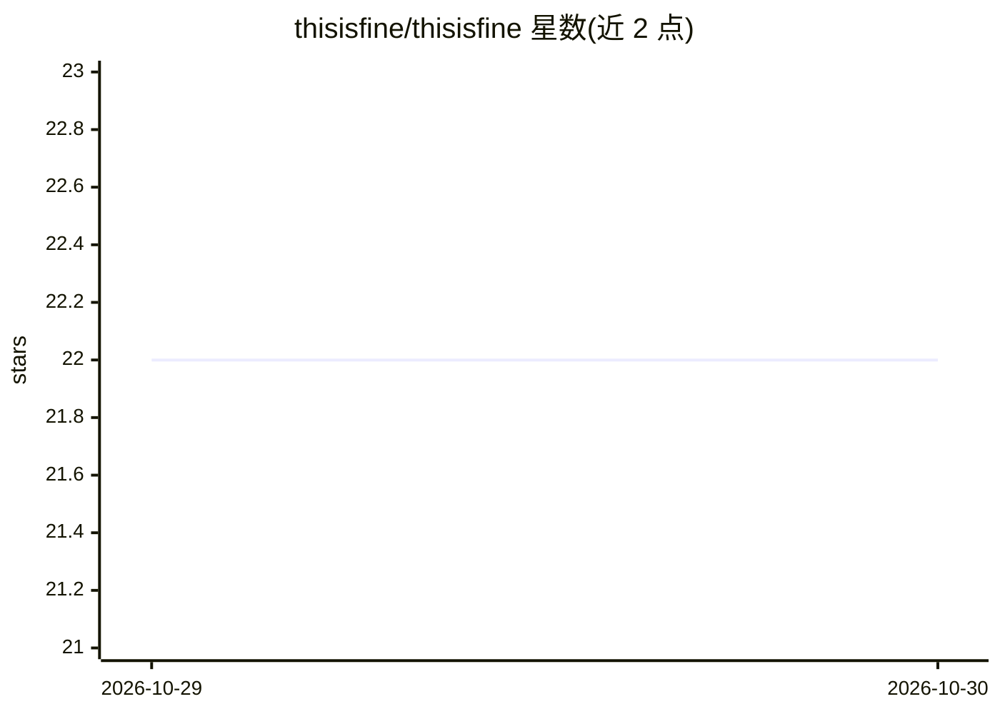

# thisisfine/thisisfine

⭐ 22 · HTML · 推送 2026-10-27 · [GitHub](https://github.com/thisisfine/thisisfine) · [官网](https://thisisfine.us) · 个人维护

**仅含两行占位文字的仓库，无可验证功能**

README 仅两行：仓库名标题与“This readme is fine.”，未说明项目用途、目标用户或安装运行方式。主题标签为玩笑性质组合（fire、kittens、machine-distruction 等，混有 fine-tuning、machine-learning）。无法从可见材料验证任何功能、机制或限制，只能确认仓库存在且内容极简。

## 筛选速览

| 维度 | 判定 | 备注 |
|---|---|---|
| AI 角色 | `ai-knowledge` | 知识聚合/清单类 |
| 许可风险 | `none` | — |
| 部署形态 | `None` |  |
| 模型依赖 | — | README 未给出锁定关系 |
| 硬件要求 | — | 无带数字的原话,不猜 |
| 安装摩擦 | `low` | 无编译、无系统依赖或容器化 |
| 成熟度 | — | 结构信号不足 |

## 能力要点

- README 仅两行占位文字，无可验证能力

## 适用场景

- 无法从 README 确定适用场景

## 场景标签

 · 领域:未确定

## 证据(README 行号)

> L1: # thisisfine
> L2: This readme is fine.

## 星数曲线

2026-10-29 22 → 2026-10-30 22（+0）

---
*卡片 v1 · prompt 1.4 · 生成 2026-10-29 · 置信度 low · 依据 README sha `d670d7038c9b` · [字段定义](../../DATASET.md)*
