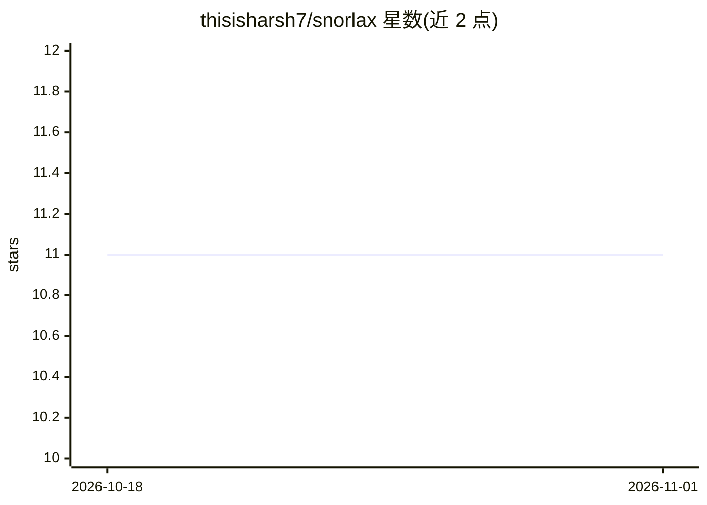

# thisisharsh7/snorlax

⭐ 11 · Python · 推送 2026-02-04 · [GitHub](https://github.com/thisisharsh7/snorlax) · 个人维护

**给开源维护者的 GitHub issue AI 分诊工具：查重、分类并起草回复**

本地优先的 GitHub issue 分诊应用：克隆仓库并用 sentence-transformers/all-MiniLM-L6-v2 生成代码与 issue 的向量嵌入，存入 PostgreSQL+pgvector，通过语义检索找出相似 issue、相关 PR 与相关代码，再调用 Claude Sonnet 4.5 做分类、优先级评分与回复草稿，经人工审核后发布。95%+ 相似度的重复 issue 由规则直接判定，7 天缓存降低重复分析成本，约 $0.003/issue。面向月均 20+ issue 的开源维护者；限制包括仅支持 GitHub.com、英文、无增量索引、逐条分析。

## 筛选速览

| 维度 | 判定 | 备注 |
|---|---|---|
| AI 角色 | `ai-native` | 本体是模型或模型工具 |
| 许可风险 | `permissive` | — |
| 部署形态 | `None` |  |
| 模型依赖 | locked-api |  |
| 硬件要求 | — | 无带数字的原话,不猜 |
| 安装摩擦 | `low` | 无编译、无系统依赖或容器化 |
| 成熟度 | — | 结构信号不足 |

## 能力要点

- 语义检索相似 issue、相关 PR、代码与文档
- 95%+ 相似度规则直接判重，跳过 LLM 调用
- 7 天响应缓存，平均成本约 $0.003/issue
- 回复草稿需人工审核后才发布

## 适用场景

- 维护月均 20+ issue 的开源项目时自动查找重复与相关 PR
- 对代码库做语义搜索以定位 issue 对应代码
- 让 AI 起草常见 issue 的回复并由我审核后发布

## 场景标签

`RAG` `语义搜索` · 领域:知识与检索

## 证据(README 行号)

> L18: Snorlax indexes your repository's code and issues, then uses semantic search + Claude AI to analyze incoming issues
> L77: 4. Send to Claude Sonnet 4.5 for categorization + draft response

## 星数曲线

2026-10-18 11 → 2026-11-01 11（+0）

---
*卡片 v1 · prompt 1.4 · 生成 2026-11-01 · 置信度 high · 依据 README sha `11a04fcf792b` · [字段定义](../../DATASET.md)*
